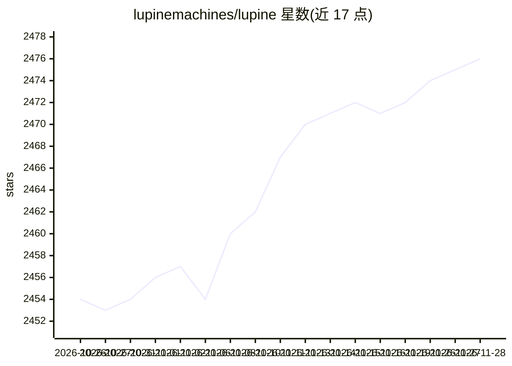

# lupinemachines/lupine

⭐ 2,476 · C++ · Apache-2.0 · 推送 2026-11-27 · [GitHub](https://github.com/lupinemachines/lupine) · [官网](https://lupine.sh) · 组织维护

**GPU-over-IP 桥：让无 GPU 机器远程挂载他机 GPU**

以 client/server 架构通过网络转发 CUDA 驱动调用：GPU 主机运行 server（Docker 镜像发布），CPU-only 机器上的客户端加载 libcuda/NVML 等 shim，使 nvidia-smi 与 CUDA 程序可访问远程 GPU；支持多服务器多 GPU 聚合为单一序号列表、跨服务器 memcpy（经客户端中转）、TLS 反代与 IPv6、TCP keepalive 与连接重试保持长连接、zstd 压缩、Prometheus 指标端点，以及可选 checkpoint provider（liblupinecr）做会话恢复。客户端对象内嵌于 server，支持 Linux/macOS/Windows、amd64/arm64。

## 筛选速览

| 维度 | 判定 | 备注 |
|---|---|---|
| AI 角色 | `ai-ecosystem` | LLM/agent 周边工具 |
| 许可风险 | `permissive` | Apache-2.0 |
| 部署形态 | `self-host` | docker 或自建部署 |
| 模型依赖 | — | README 未给出锁定关系 |
| 硬件要求 | `cpu-ok` | |
| 安装摩擦 | `low` | 无编译、无系统依赖或容器化 |
| 成熟度 | — | 结构信号不足 |

## 能力要点

- 仅驱动调用跨网络：程序自带 CUDA runtime 与库
- 多服务器 GPU 聚合为本地序号列表，支持跨服务器 memcpy（客户端中转）
- TCP keepalive、指数退避连接重试与 zstd 压缩保障长连接稳定
- Prometheus /metrics 暴露 GPU 内存、利用率与客户端进程映射

## 适用场景

- 让无 GPU 的机器运行 CUDA 程序或 PyTorch 训练
- 在多台 GPU 主机间聚合设备供单个客户端使用
- 通过 /metrics 监控远程 GPU 的内存与利用情况

## 场景标签

 · 领域:GPU/网络基础设施

## 证据(README 行号)

> L3: LUPINE is a GPU over IP bridge allowing GPUs on remote machines to be attached
> L63: CUDA runtime and libraries against it, so only driver calls cross the wire.

## 星数曲线

2026-10-26 2,454 → 2026-11-28 2,476（+22）

---
*卡片 v1 · prompt 1.4 · 生成 2026-11-27 · 置信度 high · 依据 README sha `2d6dac113950` · [字段定义](../../DATASET.md)*
