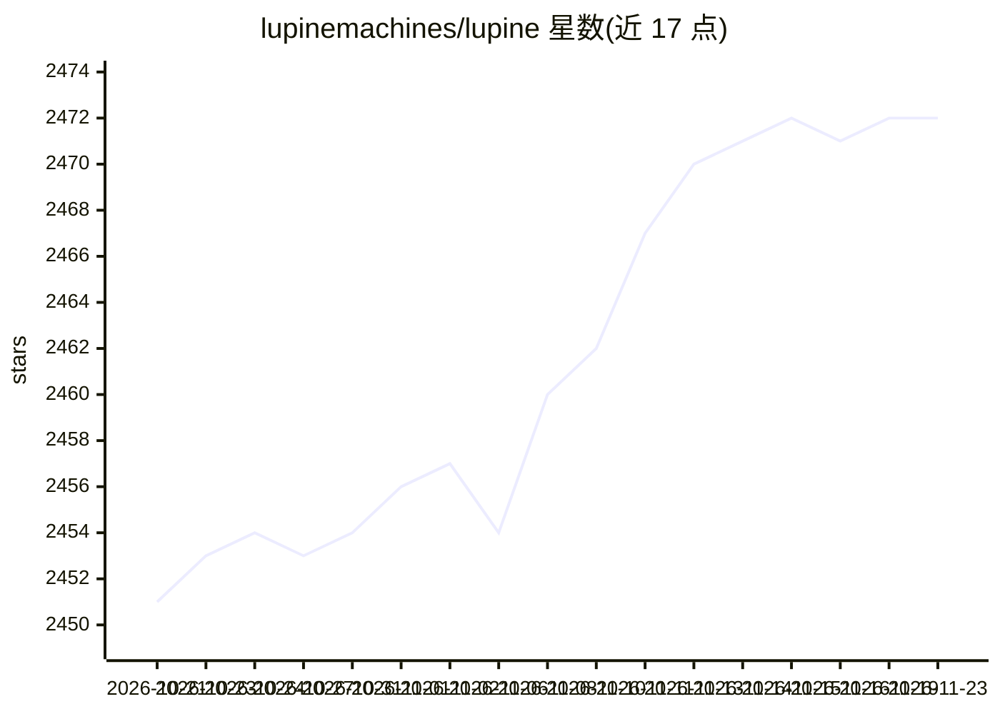

# lupinemachines/lupine

⭐ 2,472 · C++ · Apache-2.0 · 推送 2026-11-20 · [GitHub](https://github.com/lupinemachines/lupine) · [官网](https://lupine.sh) · 组织维护

**让 CPU 机器通过网络挂载远程 GPU 的桥接工具**

LUPINE 以客户端/服务端形式提供 GPU over IP 桥接：GPU 机器上运行服务端，CPU-only 机器上的程序通过 libcuda/NVML 等驱动 shim，让 CUDA 调用经单一 TCP/HTTP2 流转发到远端 GPU。支持多服务器多 GPU 统一编号、跨服务器内存拷贝、TLS 代理、TCP keepalive 与连接重试、Zstd 压缩、SIGTERM 优雅排空与可选 checkpoint provider，并在 RPC 端口暴露 Prometheus GPU 指标。官方发布 GHCR Docker 镜像，本地开发需 codegen 与 CMake 构建。

## 筛选速览

| 维度 | 判定 | 备注 |
|---|---|---|
| AI 角色 | `ai-ecosystem` | LLM/agent 周边工具 |
| 许可风险 | `permissive` | Apache-2.0 |
| 部署形态 | `self-host` | docker 或自建部署 |
| 模型依赖 | — | README 未给出锁定关系 |
| 硬件要求 | — | 无带数字的原话,不猜 |
| 安装摩擦 | `low` | 无编译、无系统依赖或容器化 |
| 成熟度 | — | 结构信号不足 |

## 能力要点

- 通过 libcuda/libnvidia-ml shim 使 CPU-only 机器运行 CUDA 程序与 nvidia-smi
- LUPINE_SERVER 列表聚合多台服务器的 GPU 为本地序号，支持跨服务器 DtoD/Peer 拷贝
- TCP keepalive、指数退避连接重试、Zstd 压缩与可选 LUPINE_COMPRESSION=none
- 服务端在 RPC 端口暴露 Prometheus GPU 内存/利用率指标，支持 SIGTERM 优雅排空

## 适用场景

- 让没有 GPU 的机器运行 PyTorch 等 CUDA 训练任务
- 将分散在多台机器上的 GPU 汇聚成一个设备列表供程序使用
- 在 NAT/防火墙等中间件环境保持长时间空闲的 CUDA 连接

## 场景标签

 · 领域:基础设施/计算资源调度

## 证据(README 行号)

> L3: LUPINE is a GPU over IP bridge allowing GPUs on remote machines to be attached
> L63: CUDA runtime and libraries against it, so only driver calls cross the wire.

## 星数曲线

2026-10-21 2,451 → 2026-11-23 2,472（+21）

---
*卡片 v1 · prompt 1.4 · 生成 2026-11-23 · 置信度 mid · 依据 README sha `06bb7f2bef9a` · [字段定义](../../DATASET.md)*
