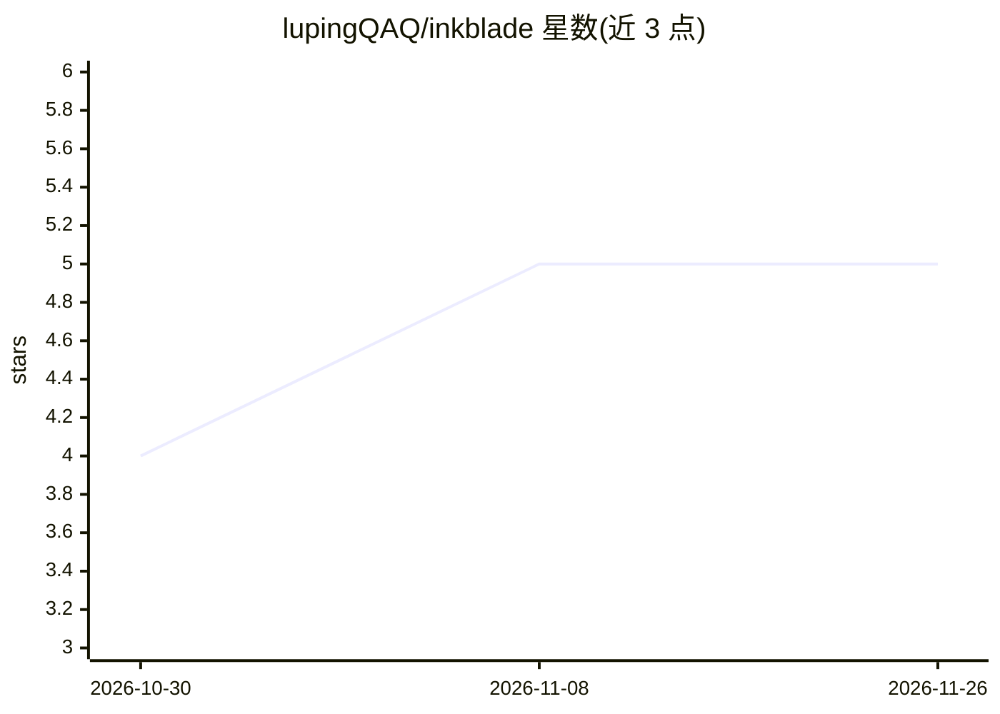

# lupingQAQ/inkblade

⭐ 5 · Python · NOASSERTION · 推送 2026-10-28 · [GitHub](https://github.com/lupingQAQ/inkblade) · [官网](https://lupingqaq.github.io/inkblade/) · 个人维护 · 中文 README

**面向 LLM 训练/推理集群的授权渗透测试框架**

InkBlade 在已授权 Pod 内投放静态 Rust 探针，按十层模板（架构、框架组件、网络、数据权重、租户隔离、供应链、缓存、防御绕过等）对 K8s+GPU 的 ML 基础设施执行声明式检测，产出双语报告、可重放的规则包与本地控制台；控制器留在集群外。内置预算化 planner 的 Agent 运行时、探针树与跨集群中继。目录基于 184 篇漏洞分析、286 个模板，仅限书面授权资产使用。

## 筛选速览

| 维度 | 判定 | 备注 |
|---|---|---|
| AI 角色 | `ai-enhanced` | 去掉 AI 部分产品仍成立 |
| 许可风险 | `none` | NOASSERTION |
| 部署形态 | `self-host` | docker 或自建部署 |
| 模型依赖 | — | README 未给出锁定关系 |
| 硬件要求 | — | 无带数字的原话,不猜 |
| 安装摩擦 | `low` | 无编译、无系统依赖或容器化 |
| 成熟度 | — | 结构信号不足 |

## 能力要点

- 十层检测模板共 286 个，探针为静态 musl 二进制（amd64/arm64）
- Agent 运行时：预算化 planner、持久 journal、可 resume/replay
- 11 个 defense-bypass 模块并生成拦截/检出/漏检矩阵的规则包
- 双语报告与 SARIF/OCSF/VEX 导出，授权记录哈希与写入备份回执强制约束

## 适用场景

- 对自有 K8s+GPU 推理集群做授权安全评估
- 验证 vLLM/SGLang 等框架管理面与插件路由的暴露面
- 测试 HIDS/eBPF/admission 等防御控制能否检出绕过手法
- 生成可重放规则包用于持续加固

## 场景标签

`网络安全` · 领域:学习与行业

## 证据(README 行号)

> L3: **Probe-centric penetration testing for training and inference clusters.**
> L5: InkBlade places a static Rust probe inside an authorized Pod, runs declarative detection templates across ten layers
> L34: - **Agent runtime.** A budgeted planner executes the objective graph, records every observation and decision, and c

## 星数曲线

2026-10-30 4 → 2026-11-26 5（+1）

---
*卡片 v1 · prompt 1.4 · 生成 2026-11-21 · 置信度 mid · 依据 README sha `e00090f742a1` · [字段定义](../../DATASET.md)*
