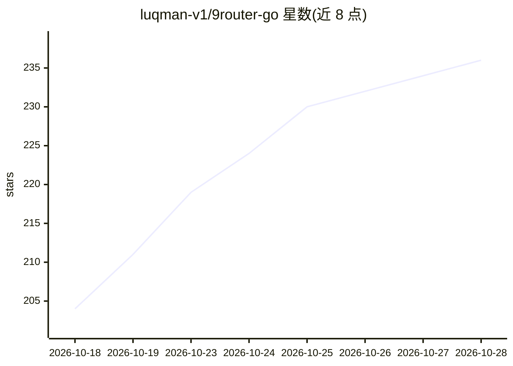

# luqman-v1/9router-go

⭐ 239 · Go · NOASSERTION · 推送 2026-10-28 · [GitHub](https://github.com/luqman-v1/9router-go) · [官网](https://luqman-v1.github.io/9router-go/) · 个人维护

**单二进制 Go 版 LLM 代理网关：路由 40+ 提供商并压缩 token**

9Router 的 Go 重实现：一个 Go 二进制同时提供代理 API 与内嵌 Svelte 仪表盘，运行时无需 Node.js。把 Claude Code、Cursor、Cline 等 CLI 编码工具接入 40+ AI 提供商与 100+ 模型；提供 RTK 工具输出压缩（自称节省 20-40% token）、订阅→低价→免费模型的自动回退、按组合的多种路由策略、多账号轮询、SQLite WAL 持久化与后台守护/自启动服务管理。可直接读取上游 9Router 的同一 SQLite 数据库，无导入迁移步骤。

## 筛选速览

| 维度 | 判定 | 备注 |
|---|---|---|
| AI 角色 | `ai-ecosystem` | LLM/agent 周边工具 |
| 许可风险 | `none` | NOASSERTION |
| 部署形态 | `desktop` | 安装包/桌面程序 |
| 模型依赖 | local-ok | 支持本地模型 |
| 硬件要求 | — | 无带数字的原话,不猜 |
| 安装摩擦 | `low` | 无编译、无系统依赖或容器化 |
| 成熟度 | — | 结构信号不足 |

## 能力要点

- RTK Token Saver 自动压缩 tool_result 内容
- Subscription→Cheap→Free 自动回退与多种组合路由策略
- 单 Go 二进制内嵌 Svelte 仪表盘，运行时无需 Node.js
- 与上游 9Router 共用同一 SQLite 数据库，无迁移步骤

## 适用场景

- 让 Claude Code/Cursor 等 CLI 编码工具统一接入多家 AI 提供商
- 配额耗尽或限流时自动回退到免费/低价模型
- 压缩 git diff 等工具输出以减少 token 消耗
- 多账号与代理池管理

## 场景标签

`模型网关` · 领域:Agent 开发

## 证据(README 行号)

> L18: Same idea as 9Router, minus the Node.js runtime: **one Go binary** serves the proxy APIs + an embedded Svelte dashb
> L139: - 🔌 OpenAI Chat, Claude Messages, Gemini, Ollama-compatible, Responses, embeddings, media, search, web tools
> L117:   Endpoint: http://localhost:20130/v1

## 星数曲线

2026-10-18 204 → 2026-10-28 236（+32）

---
*卡片 v1 · prompt 1.4 · 生成 2026-10-22 · 置信度 high · 依据 README sha `e96faa70ef8d` · [字段定义](../../DATASET.md)*
