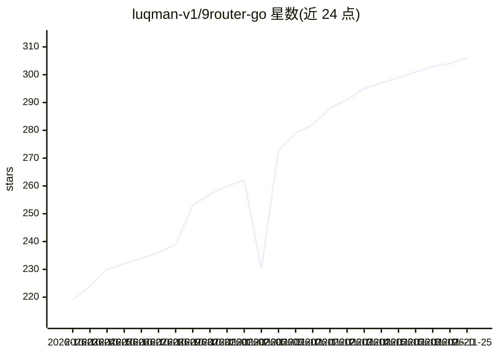

# luqman-v1/9router-go

⭐ 306 · Go · NOASSERTION · 推送 2026-11-24 · [GitHub](https://github.com/luqman-v1/9router-go) · [官网](https://luqman-v1.github.io/9router-go/) · 个人维护

**面向 CLI 编码工具的 Go 单二进制 LLM 代理网关与令牌节省器**

9Router 的 Go 重写版：单二进制运行，无需 Node.js，内置 Svelte 仪表盘。将 Claude Code、Cursor、Codex 等工具接入 150+ 提供商与 1000+ 模型，提供 RTK 工具输出压缩（节省 20-40% tokens）、订阅→低价→免费的多级自动回退、combo 路由策略（fallback/round-robin/sticky/fusion）、多账号轮换、按 API key 绑定代理池、SQLite WAL 持久化与用量日志。可与上游 9Router 共享同一数据库。

## 筛选速览

| 维度 | 判定 | 备注 |
|---|---|---|
| AI 角色 | `ai-ecosystem` | LLM/agent 周边工具 |
| 许可风险 | `none` | NOASSERTION |
| 部署形态 | `self-host` | docker 或自建部署 |
| 模型依赖 | local-ok | 支持本地模型 |
| 硬件要求 | — | 无带数字的原话,不猜 |
| 安装摩擦 | `low` | 无编译、无系统依赖或容器化 |
| 成熟度 | — | 结构信号不足 |

## 能力要点

- RTK Token Saver 自动压缩 tool_result 内容，节省 20-40% tokens
- 多级自动回退（订阅→低价→免费）与 per-combo 路由策略
- 单二进制含嵌入式 Svelte 仪表盘，支持后台守护与开机自启
- 与上游 9Router 直接共享同一 SQLite 数据库，无需迁移

## 适用场景

- 为多个 CLI 编码工具统一接入 150+ AI 提供商与模型
- 订阅配额与限流场景下自动切换到免费/低价模型
- 压缩 git diff、grep 等工具输出以降低 token 消耗
- 在无 Node.js 环境下运行 9Router 兼容网关

## 场景标签

`模型网关` · 领域:Agent 开发

## 证据(README 行号)

> L9: **Connect Claude Code, Cursor, Antigravity, Codex, Gemini, OpenCode, Cline, OpenClaw... to 150+ AI providers & 1000+
> L22: Same idea as 9Router, minus the Node.js runtime: **one Go binary** serves the proxy APIs + an embedded Svelte dashb
> L42: - ✅ **Single binary** — Go + embedded dashboard, works with Claude Code, Codex, Cursor, Cline, any CLI tool

## 星数曲线

2026-10-23 219 → 2026-11-25 306（+87）

---
*卡片 v1 · prompt 1.4 · 生成 2026-11-25 · 置信度 high · 依据 README sha `2df7385239e7` · [字段定义](../../DATASET.md)*
