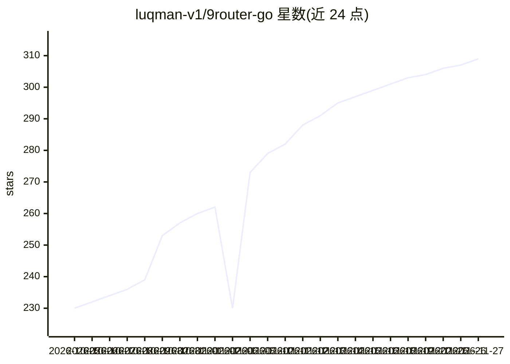

# luqman-v1/9router-go

⭐ 309 · Go · NOASSERTION · 推送 2026-11-26 · [GitHub](https://github.com/luqman-v1/9router-go) · [官网](https://luqman-v1.github.io/9router-go/) · 个人维护

**Go 单二进制 LLM 代理网关：为 CLI 编码工具接入多家 AI 提供商并省 token**

9Router 的 Go 实现：单个二进制同时提供代理 API 与内嵌 Svelte 仪表盘，面向 Claude Code、Cursor、Cline 等 CLI 编码工具，接入 150+ 提供商与 1000+ 模型。核心机制包括 RTK 工具输出压缩（宣称节省 20-40% token）、订阅→低价→免费的自动回退、每组合路由策略（回退/轮询/粘性/容量/融合）、按密钥代理池、SQLite WAL 持久化与预算硬切断。与上游 9Router 共享同一 SQLite 数据库，无需迁移。支持后台守护、开机自启、Docker、OpenWrt opkg 包及 no-AVX 二进制变体。

## 筛选速览

| 维度 | 判定 | 备注 |
|---|---|---|
| AI 角色 | `ai-ecosystem` | LLM/agent 周边工具 |
| 许可风险 | `none` | NOASSERTION |
| 部署形态 | `self-host` | docker 或自建部署 |
| 模型依赖 | local-ok | 支持本地模型 |
| 硬件要求 | — | 无带数字的原话,不猜 |
| 安装摩擦 | `low` | 无编译、无系统依赖或容器化 |
| 成熟度 | — | 结构信号不足 |

## 能力要点

- 单二进制内置代理 API 与 Svelte 仪表盘，运行时无需 Node.js
- RTK Token Saver 自动压缩 tool_result 内容，自动回退到免费/低价模型
- 与上游 9Router 读写同一 SQLite 数据库，配置与用量历史直接沿用
- 按模型熔断器、按密钥预算硬切断、后台守护与多后端开机自启

## 适用场景

- 让 Claude Code/Cursor 等 CLI 工具通过统一本地端点使用多家 AI 提供商
- 为团队成员管理多账号轮询、代理池与用量预算
- 在无 Node.js 环境或 OpenWrt 路由器上运行 LLM 网关

## 场景标签

`模型网关` · 领域:Agent 开发

## 证据(README 行号)

> L22: Same idea as 9Router, minus the Node.js runtime: **one Go binary** serves the proxy APIs + an embedded Svelte dashb
> L42: - ✅ **Single binary** — Go + embedded dashboard, works with Claude Code, Codex, Cursor, Cline, any CLI tool
> L155: - 🔌 OpenAI Chat, Claude Messages, Gemini, Ollama-compatible, Responses, embeddings, media, search, web tools, rera

## 星数曲线

2026-10-25 230 → 2026-11-27 309（+79）

---
*卡片 v1 · prompt 1.4 · 生成 2026-11-27 · 置信度 high · 依据 README sha `6ab2c4bc8e66` · [字段定义](../../DATASET.md)*
