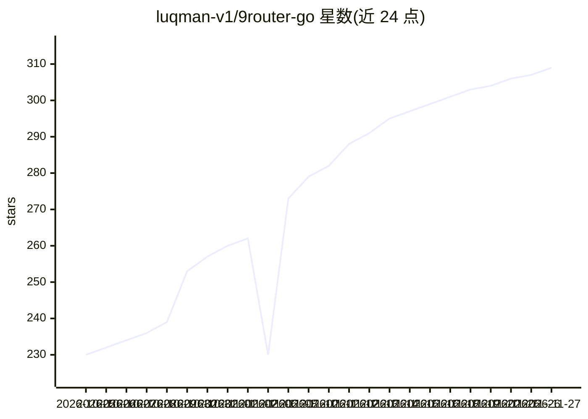

# luqman-v1/9router-go

⭐ 309 · Go · NOASSERTION · 推送 2026-11-26 · [GitHub](https://github.com/luqman-v1/9router-go) · [官网](https://luqman-v1.github.io/9router-go/) · 个人维护 · 中文 README

**Go 编写的 LLM 代理网关：把 CLI 工具接入 150+ 提供商并省 token**

9Router 的 Go 重写版，单二进制包含代理 API 与内嵌 Svelte 仪表盘，运行时无需 Node.js。功能包括 RTK 工具结果压缩（宣称省 20-40% token）、订阅→低价→免费模型的自动回退、按组合的路由策略（回退/轮询/粘性/容量/融合）、多账号轮询、按 API key 绑定代理池、每模型熔断、SQLite WAL 持久化与后台守护/开机自启。可与上游 9Router 共享同一 SQLite 数据库。提供安装脚本、Docker 镜像与源码构建。

## 筛选速览

| 维度 | 判定 | 备注 |
|---|---|---|
| AI 角色 | `ai-ecosystem` | LLM/agent 周边工具 |
| 许可风险 | `none` | NOASSERTION |
| 部署形态 | `self-host` | docker 或自建部署 |
| 模型依赖 | local-ok | 支持本地模型 |
| 硬件要求 | — | 无带数字的原话,不猜 |
| 安装摩擦 | `low` | 无编译、无系统依赖或容器化 |
| 成熟度 | — | 结构信号不足 |

## 能力要点

- 单二进制运行：Go 代理 API + 内嵌 Svelte 仪表盘，无 Node.js 运行时依赖
- RTK 工具结果压缩与订阅→低价→免费自动回退路由
- 每模型熔断、按 API key 代理池绑定、每 key 预算硬截断
- 与上游 9Router 直接共享同一 SQLite 数据库，无迁移步骤

## 适用场景

- 让 Claude Code/Cursor 等 CLI 工具通过统一本地端点调用 150+ 提供商
- 在配额与限流间自动回退到免费或低价模型以降低开销
- 为多个提供商账号做轮询与代理池隔离
- 从 Node.js 版 9Router 平迁到 Go 版而不迁移数据

## 场景标签

`模型网关` · 领域:Agent 开发

## 证据(README 行号)

> L22: Same idea as 9Router, minus the Node.js runtime: **one Go binary** serves the proxy APIs + an embedded Svelte dashb
> L34: - ✅ **Auto fallback** — Subscription → Cheap → Free, zero downtime
> L155: - 🔌 OpenAI Chat, Claude Messages, Gemini, Ollama-compatible, Responses, embeddings, media, search, web tools, rera

## 星数曲线

2026-10-25 230 → 2026-11-27 309（+79）

---
*卡片 v1 · prompt 1.4 · 生成 2026-11-26 · 置信度 high · 依据 README sha `b0d831520eb6` · [字段定义](../../DATASET.md)*
