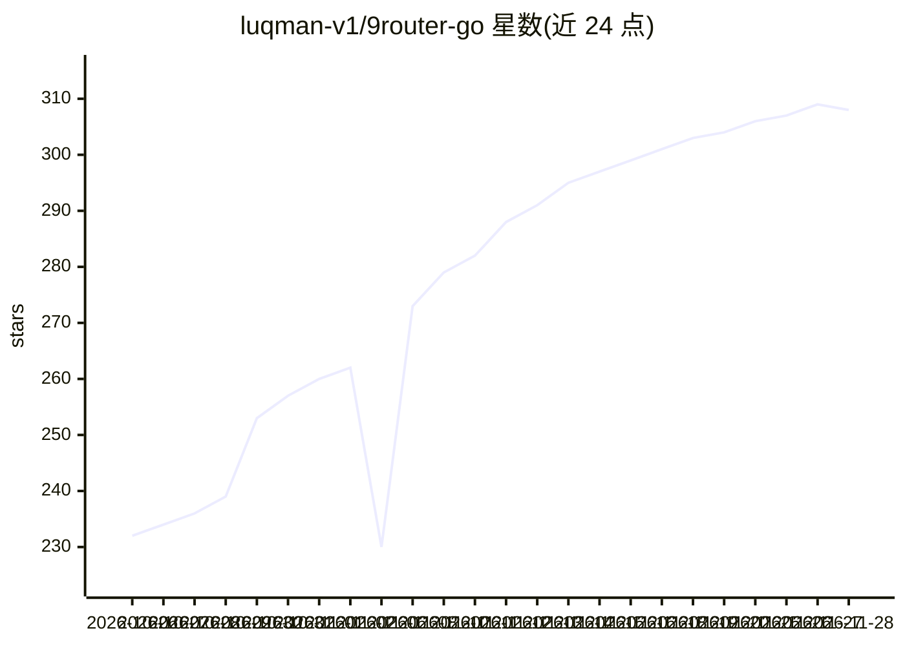

# luqman-v1/9router-go

⭐ 308 · Go · NOASSERTION · 推送 2026-11-27 · [GitHub](https://github.com/luqman-v1/9router-go) · [官网](https://luqman-v1.github.io/9router-go/) · 个人维护 · 中文 README

**给 CLI 编码工具省 token 的 Go 单文件 LLM 路由网关**

9Router 的 Go 单二进制重写：以本地代理网关形式运行，将 Claude Code、Cursor、Codex、Cline 等 CLI 工具接入 150+ 提供商与 1000+ 模型，运行时无需 Node.js。内置 RTK Token Saver 自动压缩 tool_result 内容（自称省 20-40% token）、订阅→低价→免费的自动 fallback、组合路由策略（fallback/round-robin/sticky/capacity/fusion）、多账号轮换、按 key 代理池、熔断与预算限额，附带内嵌 Svelte 仪表盘与 SQLite WAL 持久化，可与上游 9Router 共享同一数据库。

## 筛选速览

| 维度 | 判定 | 备注 |
|---|---|---|
| AI 角色 | `ai-ecosystem` | LLM/agent 周边工具 |
| 许可风险 | `none` | NOASSERTION |
| 部署形态 | `self-host` | docker 或自建部署 |
| 模型依赖 | local-ok | 支持本地模型 |
| 硬件要求 | — | 无带数字的原话,不猜 |
| 安装摩擦 | `low` | 无编译、无系统依赖或容器化 |
| 成熟度 | — | 结构信号不足 |

## 能力要点

- 单个 Go 二进制含代理 API 与内嵌 Svelte 仪表盘，运行时无需 Node.js
- RTK Token Saver 压缩 tool_result 内容，自动 fallback 到免费/低价模型
- 组合路由策略：fallback、round-robin、sticky、capacity、fusion；按模型熔断与按 key 预算限额
- 与上游 9Router（Next.js 版）共享同一 SQLite 数据库，无需迁移

## 适用场景

- 让 Claude Code/Cursor 等 CLI 工具走本地网关接入多家模型提供商
- 用免费与低价模型自动兜底，降低订阅配额与速率限制的影响
- 压缩工具调用输出，减少编码 agent 的 token 消耗
- 需要后台守护、开机自启与用量统计的自托管 LLM 代理

## 场景标签

`模型网关` · 领域:Agent 开发

## 证据(README 行号)

> L9: **Connect Claude Code, Cursor, Antigravity, Codex, Gemini, OpenCode, Cline, OpenClaw... to 150+ AI providers & 1000+
> L22: Same idea as 9Router, minus the Node.js runtime: **one Go binary** serves the proxy APIs + an embedded Svelte dashb
> L42: - ✅ **Single binary** — Go + embedded dashboard, works with Claude Code, Codex, Cursor, Cline, any CLI tool

## 星数曲线

2026-10-26 232 → 2026-11-28 308（+76）

---
*卡片 v1 · prompt 1.4 · 生成 2026-11-28 · 置信度 high · 依据 README sha `f12a4c017326` · [字段定义](../../DATASET.md)*
