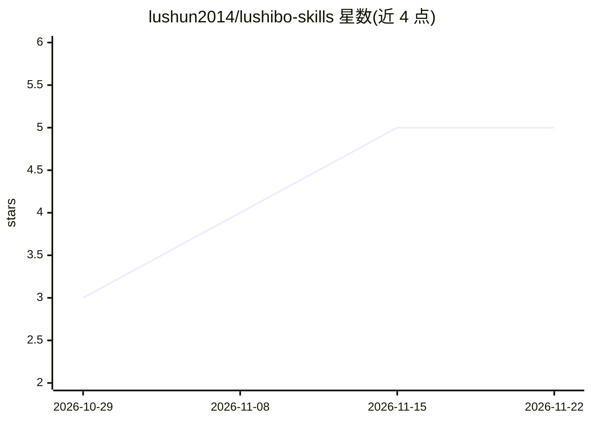

# lushun2014/lushibo-skills

⭐ 5 · Python · 推送 2026-10-15 · [GitHub](https://github.com/lushun2014/lushibo-skills) · 个人维护 · 中文 README

**CLI Agent 的 51 个技能包：覆盖安全与工程多领域**

一套面向支持 skills/ 目录约定的 CLI Agent 运行时的程序化知识包，含 51 个顶层 skill 与 1 个嵌套 skill。每个 skill 为独立目录，以 SKILL.md 的 YAML frontmatter 加「触发条件/执行步骤/交付物/验证方式」四段组织，重活另挂参考资料与可执行脚本。README 给出 Codex CLI、dsh、Hermes Agent、Claude Code 四种运行时的技能目录位置、发现方式与同步装法，并提供路由索引、工具索引与 Windows/POSIX 工具链自举脚本。仓库未附加统一开源许可，二次分发需联系作者。

## 筛选速览

| 维度 | 判定 | 备注 |
|---|---|---|
| AI 角色 | `ai-knowledge` | 知识聚合/清单类 |
| 许可风险 | `none` | — |
| 部署形态 | `None` |  |
| 模型依赖 | — | README 未给出锁定关系 |
| 硬件要求 | — | 无带数字的原话,不猜 |
| 安装摩擦 | `low` | 无编译、无系统依赖或容器化 |
| 成熟度 | — | 结构信号不足 |

## 能力要点

- 51 个顶层 skill 覆盖逆向、渗透红队、蓝队防御、游戏安全等分类
- 四段式 SKILL.md 结构（触发条件/执行步骤/交付物/验证方式）
- 提供 routing.md 路由表与 tool-index.md 工具索引
- bootstrap 脚本按能力组批量自举安装工具链

## 适用场景

- 给 Codex CLI / dsh / Hermes / Claude Code 等运行时装入安全与工程领域技能
- CTF 竞赛与已授权渗透测试中的技能路由与工具查找
- 为恶意样本分析、逆向工程搭建可复现研究工作区

## 场景标签

`网络安全` · 领域:学习与行业

## 证据(README 行号)

> L12: 一套面向 CLI Agent（Codex / dsh / Hermes / Claude Code 等支持 `skills/` 目录的运行时）的**程序化知识包**。
> L14: 按「触发条件 / 执行步骤 / 交付物 / 验证方式」四段组织；重活再挂 `references/`（参考资料）与 `scripts/`（可执行脚本）。

## 星数曲线

2026-10-29 3 → 2026-11-22 5（+2）

---
*卡片 v1 · prompt 1.4 · 生成 2026-11-21 · 置信度 high · 依据 README sha `8277e7bbc394` · [字段定义](../../DATASET.md)*
