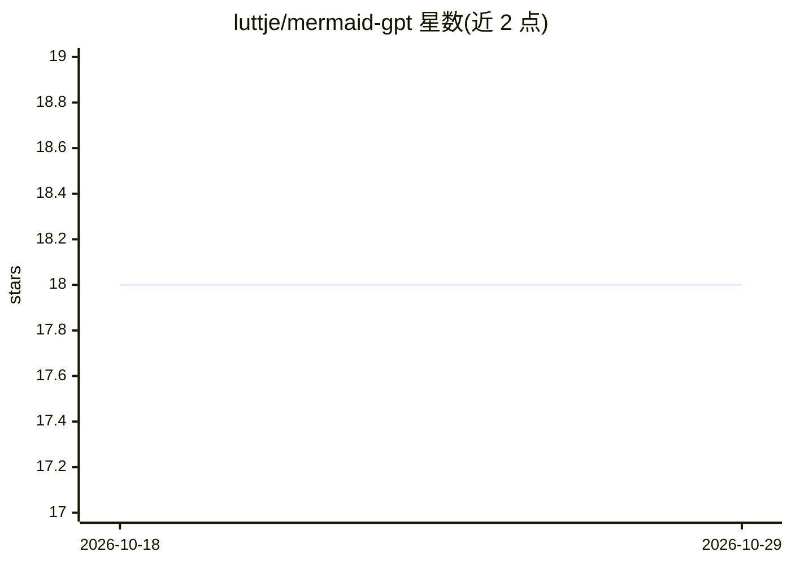

# luttje/mermaid-gpt

⭐ 18 · Svelte · MIT · 推送 2026-01-06 · [GitHub](https://github.com/luttje/mermaid-gpt) · [官网](https://luttje.github.io/mermaid-gpt/) · 个人维护

**用 GPT-3 从自然语言生成 Mermaid 图表（类图/ERD）**

基于 Svelte 的 Web 应用：用户输入文字描述，通过 OpenAI GPT-3（text-davinci-003）生成 Mermaid 格式的类图与实体关系图。OpenAI API key 仅存于浏览器 LocalStorage，不发往其他服务器，README 建议阅读源码并在本地运行。使用方式为克隆仓库后 npm install、npm run dev 启动开发服务器；提示词可在源码 prompts 文件夹查看。

## 筛选速览

| 维度 | 判定 | 备注 |
|---|---|---|
| AI 角色 | `ai-native` | 本体是模型或模型工具 |
| 许可风险 | `permissive` | MIT |
| 部署形态 | `library` | 以包/库形式分发 |
| 模型依赖 | locked-api |  |
| 硬件要求 | — | 无带数字的原话,不猜 |
| 安装摩擦 | `low` | 无编译、无系统依赖或容器化 |
| 成熟度 | — | 结构信号不足 |

## 能力要点

- 自然语言生成 Mermaid 类图与实体关系图
- 使用 GPT-3（text-davinci-003）
- API key 仅存于浏览器 LocalStorage
- 提示词在源码中公开可查

## 适用场景

- 输入文字描述快速得到 ER 图或类图草稿
- 在本地运行以安全使用自己的 OpenAI API key

## 场景标签

 · 领域:开发者工具/图表生成

## 证据(README 行号)

> L3: Generates mermaid Class and Entity Relationship Diagrams based on your description, using GPT-3 (`text-davinci-003`)
> L5: To use it head over to the 💻 MermaidGPT demo, enter your OpenAI API key and start generating diagrams.

## 星数曲线

2026-10-18 18 → 2026-10-29 18（+0）

---
*卡片 v1 · prompt 1.4 · 生成 2026-10-29 · 置信度 high · 依据 README sha `4057cd490ad6` · [字段定义](../../DATASET.md)*
