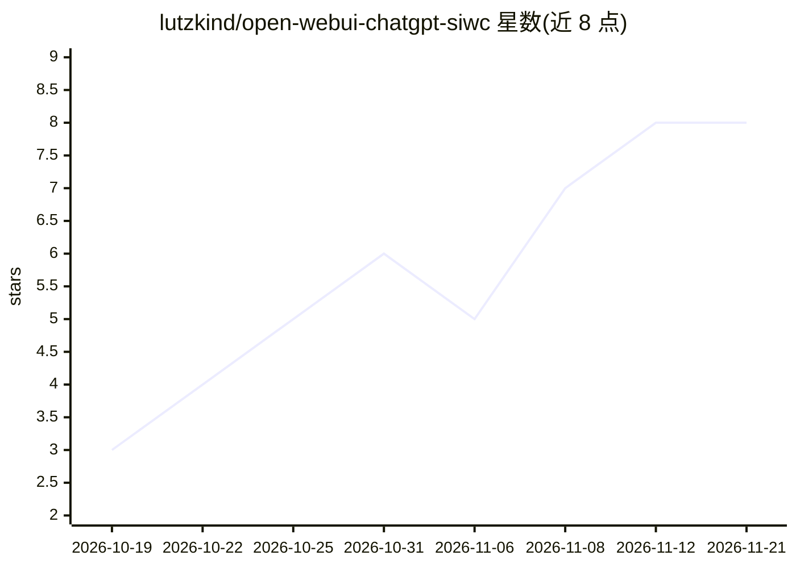

# lutzkind/open-webui-chatgpt-siwc

⭐ 8 · Python · MIT · 推送 2026-10-18 · [GitHub](https://github.com/lutzkind/open-webui-chatgpt-siwc) · 个人维护

**把 ChatGPT 订阅接入自托管 Open WebUI 的 SIWC 适配器**

独立社区维护的适配器，部署在自托管 Open WebUI 与 OpenAI 之间：通过官方 Sign in with ChatGPT (SIWC) OAuth 流程接收订阅账号凭证，加密存储，动态发现账号可用模型，并转发 OpenAI 兼容的 Responses API 请求（支持 HTTP/SSE 与 WebSocket 两种传输）。支持 reasoning_effort 映射、函数工具透传、提示缓存断点标记与会话缓存路由。要求 Docker Compose、公网 HTTPS 来源及 macOS 13.5+ 的本地配套应用完成授权。

## 筛选速览

| 维度 | 判定 | 备注 |
|---|---|---|
| AI 角色 | `ai-ecosystem` | LLM/agent 周边工具 |
| 许可风险 | `permissive` | MIT |
| 部署形态 | `self-host` | docker 或自建部署 |
| 模型依赖 | — | README 未给出锁定关系 |
| 硬件要求 | — | 无带数字的原话,不猜 |
| 安装摩擦 | `low` | 无编译、无系统依赖或容器化 |
| 成熟度 | — | 结构信号不足 |

## 能力要点

- 通过官方 SIWC OAuth 流程使用 ChatGPT 订阅推理，非 API key 通道
- 支持 HTTP/SSE 与 Responses WebSocket 两种上游传输
- 动态模型发现、reasoning_effort 映射与函数工具透传
- 提供缓存断点标记与会话缓存路由（默认关闭）

## 适用场景

- 已有 ChatGPT 订阅想在自托管 Open WebUI 中使用
- 为团队 Open WebUI 部署接入订阅账号的模型列表
- 需要 WebSocket 传输实现多轮会话续接

## 场景标签

`模型网关` · 领域:Agent 开发

## 证据(README 行号)

> L16: The adapter holds encrypted SIWC credentials, discovers the models available to the connected account, and forwards
> L3: Use an eligible ChatGPT subscription with self-hosted Open WebUI through OpenAI's official Sign in with ChatGPT (SIW

## 星数曲线

2026-10-19 3 → 2026-11-21 8（+5）

---
*卡片 v1 · prompt 1.4 · 生成 2026-11-20 · 置信度 mid · 依据 README sha `902e184385bf` · [字段定义](../../DATASET.md)*
