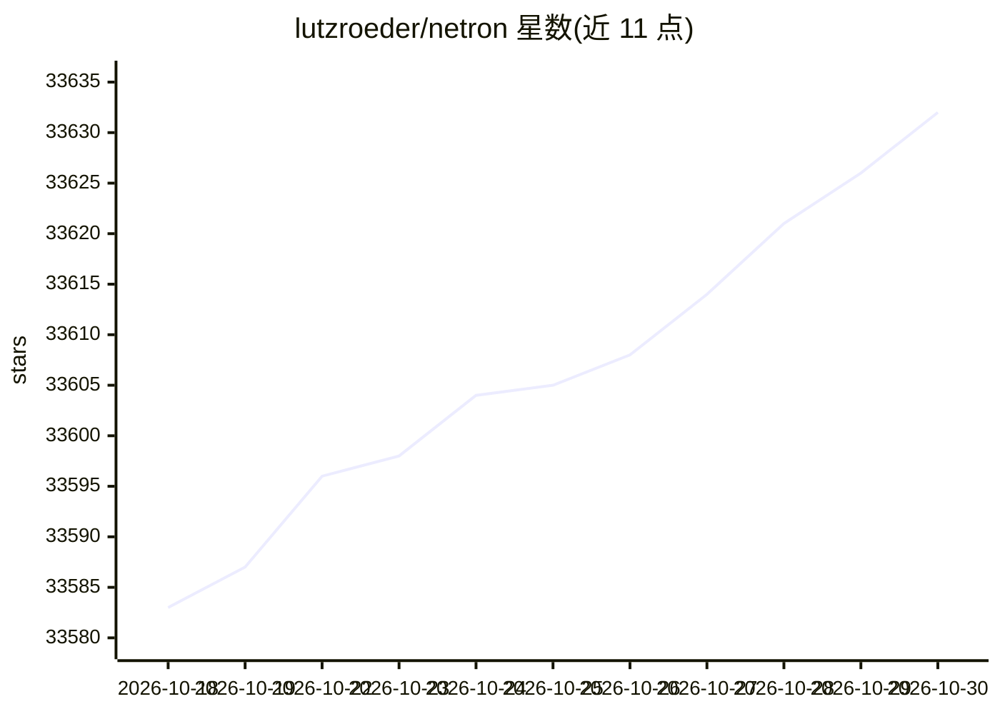

# lutzroeder/netron

⭐ 33,632 · JavaScript · MIT · 推送 2026-10-28 · [GitHub](https://github.com/lutzroeder/netron) · [官网](https://netron.app) · 个人维护

**神经网络与机器学习模型的可视化查看器**

Netron 是一个模型结构查看工具，以图形方式展示神经网络、深度学习与机器学习模型的层次结构。支持 ONNX、TensorFlow Lite、PyTorch、TensorFlow、Core ML、Keras 等格式的主线支持，并对 MLIR、GGUF、PaddlePaddle 等提供实验性支持。可通过浏览器、macOS/Linux/Windows 桌面安装包或 Python 包（pip install netron）使用，附带示例模型文件供打开浏览。

## 筛选速览

| 维度 | 判定 | 备注 |
|---|---|---|
| AI 角色 | `ai-ecosystem` | LLM/agent 周边工具 |
| 许可风险 | `permissive` | MIT |
| 部署形态 | `desktop` | 安装包/桌面程序 |
| 模型依赖 | — | README 未给出锁定关系 |
| 硬件要求 | — | 无带数字的原话,不猜 |
| 安装摩擦 | `low` | 无编译、无系统依赖或容器化 |
| 成熟度 | — | 结构信号不足 |

## 动量与使用信号

- 维护:`active` — 距上次 push 0.6 天,年发版 7,1 位贡献者
- 涨星:近 1 天 **+7**(自 20261016 起算)
- 安装:pypi 包 `netron` 月下载 70,054
- 平台:WINDOWS / MACOS / LINUX · 协议:—

## 能力要点

- 支持 ONNX、TensorFlow Lite、PyTorch、Core ML 等多种模型格式
- 提供浏览器、桌面应用与 Python 库多种使用方式
- 对 MLIR、GGUF、RKNN、PaddlePaddle 等提供实验性支持
- 提供多种格式的示例模型文件

## 适用场景

- 在浏览器中打开并查看模型网络结构
- 本地安装桌面应用检查 ONNX 或 TFLite 模型
- 用 Python 在代码中启动模型可视化服务

## 场景标签

 · 领域:机器学习/开发工具

## 证据(README 行号)

> L1: Netron is a viewer for neural network, deep learning and machine learning models.
> L3: Netron supports ONNX, TensorFlow Lite, PyTorch, torch.export, ExecuTorch, TorchScript, TensorFlow, Core ML, OpenVINO
> L9: **Browser**: **Start** the browser version.

## 星数曲线

2026-10-18 33,583 → 2026-10-30 33,632（+49）

---
*卡片 v1 · prompt 1.4 · 生成 2026-10-18 · 置信度 high · 依据 README sha `5c9b5c69c009` · [字段定义](../../DATASET.md)*
