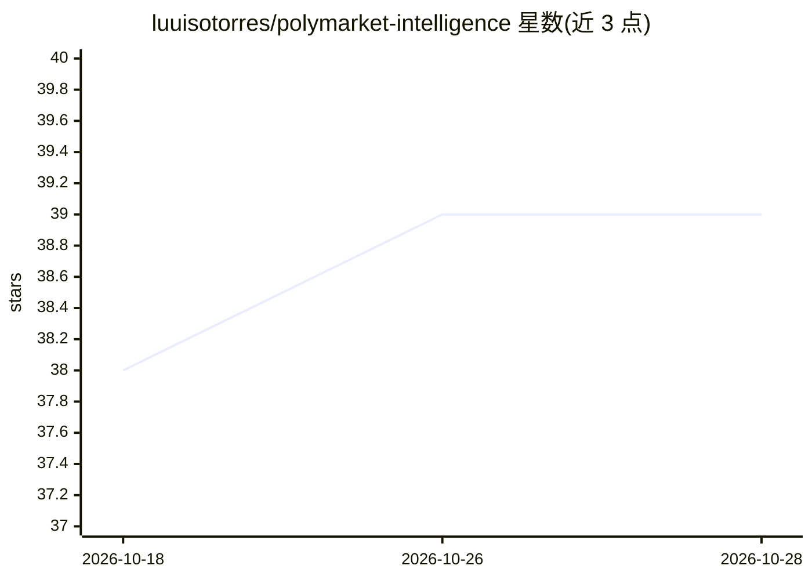

# luuisotorres/polymarket-intelligence

⭐ 39 · Python · 推送 2026-02-10 · [GitHub](https://github.com/luuisotorres/polymarket-intelligence) · 个人维护

**Polymarket 实时追踪面板：行情、新闻、鲸鱼订单与多智能体辩论分析**

面向预测市场参与者的全栈追踪仪表盘：React 前端 + FastAPI 后端 + SQLite，展示 Top100 市场、实时价格图表、聚合新闻（NewsAPI）、大额订单（鲸鱼）追踪、Top 持仓者分析与交易信号。其中 AI 功能为 AI Debate Floor：基于 LangChain/LangGraph 的多智能体辩论系统，多个专职 agent（统计、时间衰减、持仓分析等）从不同视角分析市场后给出结论，需 Gemini 与 Tavily API key。提供源码脚本启动与 Docker Compose 两种部署方式，运行需 Python 3.12+、Node.js 18+ 与多个外部 API key。

## 筛选速览

| 维度 | 判定 | 备注 |
|---|---|---|
| AI 角色 | `ai-enhanced` | 去掉 AI 部分产品仍成立 |
| 许可风险 | `none` | — |
| 部署形态 | `self-host` | docker 或自建部署 |
| 模型依赖 | — | README 未给出锁定关系 |
| 硬件要求 | — | 无带数字的原话,不猜 |
| 安装摩擦 | `low` | 无编译、无系统依赖或容器化 |
| 成熟度 | — | 结构信号不足 |

## 能力要点

- Top100 市场看板、多时间框架实时价格图表（Polymarket CLOB API）
- 大额订单实时追踪与鲸鱼行为分级标注（业绩/资金体量）
- AI Debate Floor：多智能体辩论分析并输出最终判定
- Docker Compose 一键部署全栈（FastAPI + React/nginx）

## 适用场景

- 实时跟踪 Polymarket 市场行情与价格走势
- 监控鲸鱼大额订单并查看其历史表现分级
- 用多个 AI agent 辩论的方式获取市场分析结论
- 按市场检索相关新闻辅助判断

## 场景标签

`金融量化` `多智能体` · 领域:Agent 开发

## 证据(README 行号)

> L71: ### Top 100 Markets Dashboard
> L182: |`GEMINI_API_KEY`|Google Gemini API Key|Required for AI Debate|

## 星数曲线

2026-10-18 38 → 2026-10-28 39（+1）

---
*卡片 v1 · prompt 1.4 · 生成 2026-10-25 · 置信度 mid · 依据 README sha `84fb379e408f` · [字段定义](../../DATASET.md)*
