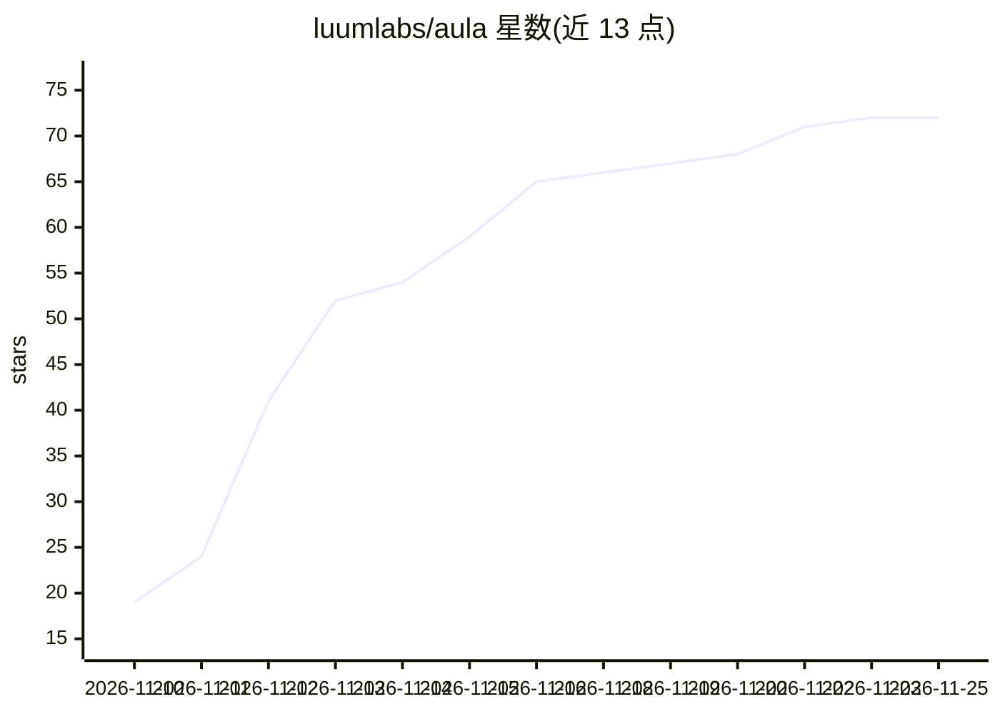

# luumlabs/aula

⭐ 72 · TypeScript · AGPL-3.0 · 推送 2026-11-23 · [GitHub](https://github.com/luumlabs/aula) · [官网](https://github.com/luumlabs/aula/releases/latest) · 组织维护

**免费开源 AI 家教与学习应用：把笔记课件变成课程与测验**

基于 Electron/TypeScript/React 的桌面学习应用：导入讲义、幻灯片、往年试题，或从 Moodle、Canvas 等平台拉取课程材料，由一组 AI agent 生成课程、习题（作答时即时批改）、间隔重复闪卡（FSRS）与模拟真实考试结构的定时模拟考。AI 可接 Claude/ChatGPT 订阅（官方 CLI）、API key（Anthropic/OpenAI/Gemini/OpenRouter/DeepSeek 等）或本地 LLM（自动下载 llama.cpp 与模型，检测 Ollama/LM Studio）。数据本地存储，无账户无追踪。README 自述处于早期访问阶段，Windows 版未代码签名。提供 Windows/macOS/Linux 安装包、Docker 无头服务器与手机端窗口。

## 筛选速览

| 维度 | 判定 | 备注 |
|---|---|---|
| AI 角色 | `ai-native` | 本体是模型或模型工具 |
| 许可风险 | `viral` | AGPL-3.0 |
| 部署形态 | `desktop` | 安装包/桌面程序 |
| 模型依赖 | local-ok | 支持本地模型 |
| 硬件要求 | — | 无带数字的原话,不猜 |
| 安装摩擦 | `low` | 无编译、无系统依赖或容器化 |
| 成熟度 | `idea` | |

## 能力要点

- AI agent 团队从笔记/幻灯片/录音/白板照片自动生成课程、习题与闪卡
- FSRS 间隔重复闪卡与错题本（1/3/7/16/35 天重现）
- 模拟考按真实考试的节数、时长与分值生成，考后按主题出报告
- 本地 LLM 支持：按 RAM 推荐模型并自动下载 llama.cpp，可完全离线

## 适用场景

- 把课堂笔记和往年试题整理成带习题和闪卡的自学课程
- 备考时做与真实考试同结构的定时模拟考
- 用已有的 Claude/ChatGPT 订阅或本地离线模型驱动 AI 家教答疑

## 场景标签

`文档问答` · 领域:知识与检索

## 证据(README 行号)

> L7:  Turn your class notes into a course, with an AI tutor that studies it with you.
> L18:  Ten seconds of Aula: lecture notes, slides, a whiteboard photo and a class recording are dropped into a new course
> L75: - **Your AI, or a free one that runs offline.** The Claude or ChatGPT subscription you already pay for, an API key,

## 星数曲线

2026-11-10 19 → 2026-11-25 72（+53）

---
*卡片 v1 · prompt 1.4 · 生成 2026-11-18 · 置信度 high · 依据 README sha `7e7bcb0157c5` · [字段定义](../../DATASET.md)*
