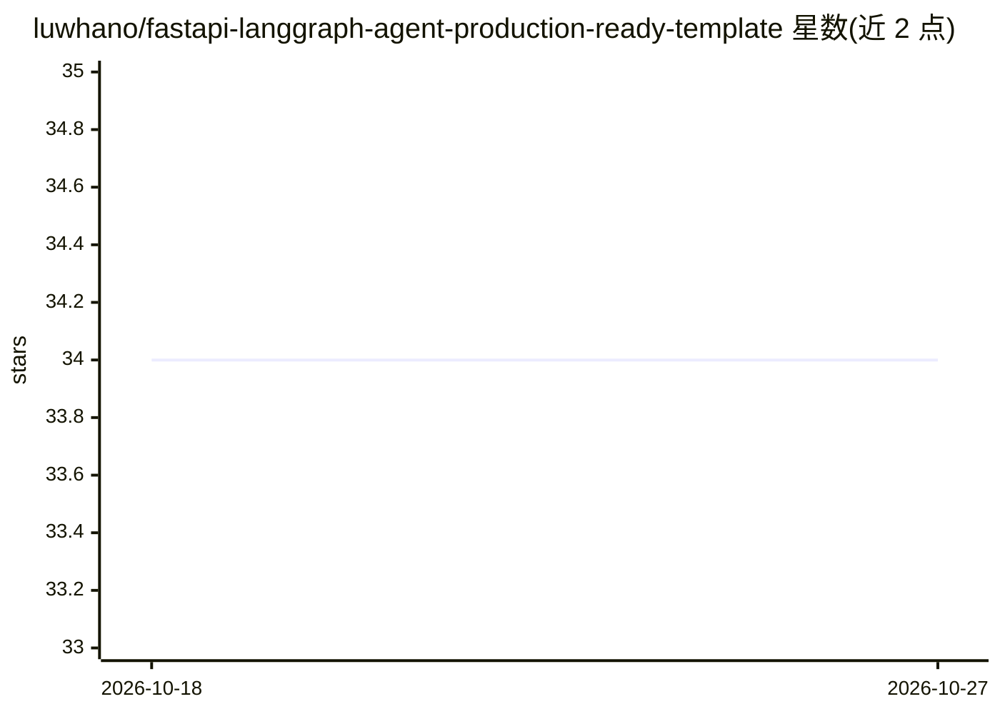

# luwhano/fastapi-langgraph-agent-production-ready-template

⭐ 34 · Python · 推送 2026-10-12 · [GitHub](https://github.com/luwhano/fastapi-langgraph-agent-production-ready-template) · 个人维护

**给开发者的 FastAPI + LangGraph AI agent 服务模板**

基于 FastAPI 构建 AI agent 服务的项目模板，集成 LangGraph 用于构建 agent 及管理工作流。技术栈包含 Python 3.8+、Docker/Docker Compose 容器化部署、PostgreSQL 数据存储与 Redis 缓存/消息代理。提供 agents 的增删改查 API 端点示例、单元与集成测试目录，运行方式为 docker-compose build/up 或从 Releases 下载直接执行。README 以功能特性描述为主，未给出具体业务实现细节。

## 筛选速览

| 维度 | 判定 | 备注 |
|---|---|---|
| AI 角色 | `ai-ecosystem` | LLM/agent 周边工具 |
| 许可风险 | `none` | — |
| 部署形态 | `self-host` | docker 或自建部署 |
| 模型依赖 | — | README 未给出锁定关系 |
| 硬件要求 | — | 无带数字的原话,不猜 |
| 安装摩擦 | `low` | 无编译、无系统依赖或容器化 |
| 成熟度 | — | 结构信号不足 |

## 能力要点

- FastAPI + LangGraph 集成的项目结构模板
- docker-compose 构建与启动
- 提供 agents CRUD API 端点（POST/GET/PUT/DELETE）
- 包含单元与集成测试目录，可用 pytest 运行

## 适用场景

- 快速搭建基于 FastAPI 的 AI agent 后端服务
- 以容器化方式部署 agent API
- 作为团队项目的标准化起点结构

## 场景标签

`Agent 框架` · 领域:Agent 开发

## 证据(README 行号)

> L5: Welcome to the **FastAPI LangGraph Agent Production-Ready Template**! This repository provides a solid foundation fo
> L12: - **LangGraph Integration**: Seamlessly connect your AI agents to the LangGraph ecosystem.
> L23: - **LangGraph**: A powerful tool for building AI agents and managing their workflows.

## 星数曲线

2026-10-18 34 → 2026-10-27 34（+0）

---
*卡片 v1 · prompt 1.4 · 生成 2026-10-25 · 置信度 high · 依据 README sha `d41b299d88ff` · [字段定义](../../DATASET.md)*
