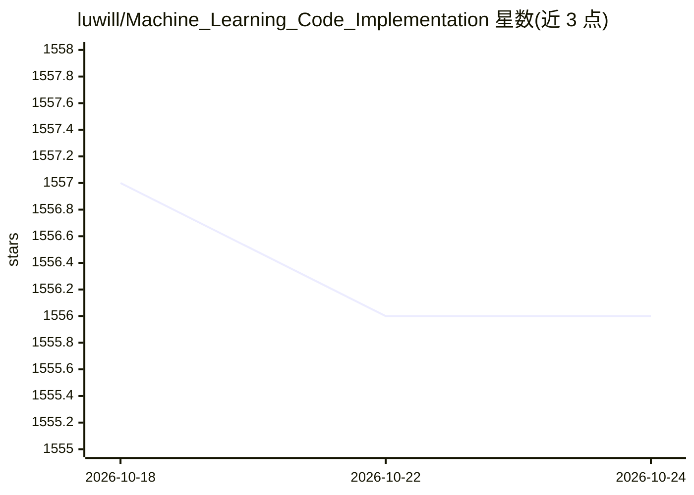

# luwill/Machine_Learning_Code_Implementation

⭐ 1,556 · Jupyter Notebook · 推送 2026-04-29 · [GitHub](https://github.com/luwill/Machine_Learning_Code_Implementation) · 个人维护 · 中文 README

**《机器学习 公式推导与代码实现》一书配套算法代码库**

《机器学习 公式推导与代码实现》的配套代码仓库，基于《统计学习方法》与西瓜书的理论框架，覆盖监督学习单模型、监督学习集成模型、无监督学习、概率模型 4 大类 26 个经典算法的公式推导与 Python 实现。代码按书中章节分目录组织，仓库版本保持更新迭代，已完成两轮代码 review，含共享库 mlbook/、tests/ 测试目录与 requirements.txt。随书 PPT 与讲解视频需另行获取，采用 CC BY-NC-SA 4.0 许可。

## 筛选速览

| 维度 | 判定 | 备注 |
|---|---|---|
| AI 角色 | `ai-knowledge` | 知识聚合/清单类 |
| 许可风险 | `none` | — |
| 部署形态 | `None` |  |
| 模型依赖 | — | README 未给出锁定关系 |
| 硬件要求 | — | 无带数字的原话,不猜 |
| 安装摩擦 | `low` | 无编译、无系统依赖或容器化 |
| 成熟度 | — | 结构信号不足 |

## 能力要点

- 26 个经典机器学习算法的公式推导与代码实现
- 代码按书章节分目录组织，仓库版本持续更新
- 已建 mlbook/ 共享库与 tests/ 目录（25 个测试用例）
- 提供书籍勘误表与代码修订说明

## 适用场景

- 配合《统计学习方法》和西瓜书学习算法推导与实现
- 按章节查找某个经典算法的 Python 参考实现
- 了解书中算法实现的历史 Bug 修复与 API 现代化情况

## 场景标签

`教程课程` · 领域:学习与行业

## 证据(README 行号)

> L4: 本书在对全部机器学习算法进行分类梳理的基础之上，分别对监督学习单模型、监督学习集成模型、无监督学习模型、概率模型4个大类26个经典算法进行了相对完整的公式推导和必要的代码实现，旨在帮助机器学习入门读者完整地掌握算法细节、实现方法以及
> L7: 本仓库为《机器学习 公式推导与代码实现》一书配套代码库，相较于书中代码而言，仓库代码随时保持更新和迭代。目前仓库只开源了全书的代码，全书内容后续也会在仓库中开源。本仓库已经根据书中章节将代码分目录整理好，读者可直接点击相关章节使用该

## 星数曲线

2026-10-18 1,557 → 2026-10-24 1,556（-1）

---
*卡片 v1 · prompt 1.4 · 生成 2026-10-21 · 置信度 high · 依据 README sha `ca2f8131507a` · [字段定义](../../DATASET.md)*
