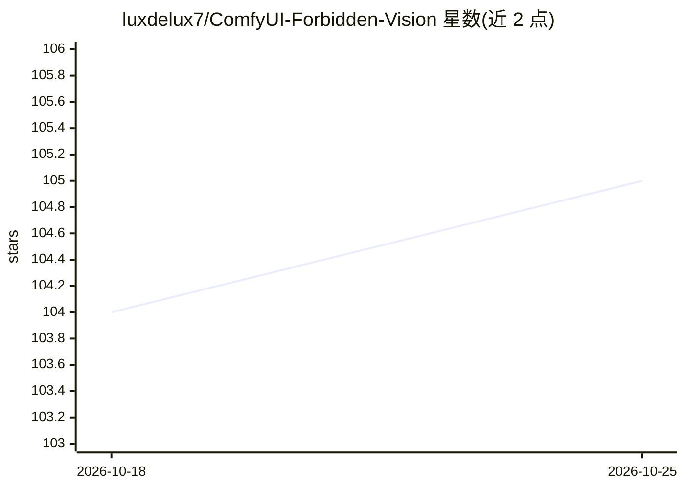

# luxdelux7/ComfyUI-Forbidden-Vision

⭐ 105 · Python · AGPL-3.0 · 推送 2026-10-11 · [GitHub](https://github.com/luxdelux7/ComfyUI-Forbidden-Vision) · [官网](https://ko-fi.com/luxdelux) · 个人维护

**ComfyUI 人脸检测/分割/修复自定义节点套件**

ComfyUI 自定义节点集，含 Fixer（人脸检测、修复与上下文感知 inpainting）、Refiner（色调/曝光自动校正与 AI 放大）、Builder/Rebuilder（采样节点，含自适应 CFG 与自校正）等节点。检测与分割使用自训练的 YOLO11 及分割模型，覆盖写实、动漫与 NSFW 内容，模型首次运行时自动从 HuggingFace 下载。支持逐脸 wildcard 提示词（[SEP]/[SKIP]/排序标签）。README 说明极端风格化或重度遮挡场景仍可能出现检测失败。通过 ComfyUI Manager 或 git clone 手动安装。

## 筛选速览

| 维度 | 判定 | 备注 |
|---|---|---|
| AI 角色 | `ai-ecosystem` | LLM/agent 周边工具 |
| 许可风险 | `viral` | AGPL-3.0 |
| 部署形态 | `None` |  |
| 模型依赖 | — | README 未给出锁定关系 |
| 硬件要求 | — | 无带数字的原话,不猜 |
| 安装摩擦 | `low` | 无编译、无系统依赖或容器化 |
| 成熟度 | — | 结构信号不足 |

## 能力要点

- 自训练 YOLO11 检测与分割模型，覆盖写实/动漫/NSFW 域
- Fixer 单节点完成检测、掩码、条件 inpainting 与差分扩散融合
- 逐脸 wildcard 提示词语法（[SEP]/[SKIP]/[ASC] 等排序标签）
- Refiner 节点自动校正色调/曝光并提供 AI 放大

## 适用场景

- 在 ComfyUI 工作流中修复或重塑生成图像中的人脸
- 为多脸图像分别指定不同提示词
- 生成后自动校正色调与曝光并放大细节

## 场景标签

`图像生成` `目标检测` `图像视频处理` · 领域:内容生成

## 证据(README 行号)

> L5:  A modern alternative to ADetailer and Impact Pack's FaceDetailer for ComfyUI using custom trained models.
> L26: 1. **Install** via ComfyUI Manager (search "Forbidden Vision") or manually

## 星数曲线

2026-10-18 104 → 2026-10-25 105（+1）

---
*卡片 v1 · prompt 1.4 · 生成 2026-10-23 · 置信度 high · 依据 README sha `4ee3fcb25609` · [字段定义](../../DATASET.md)*
