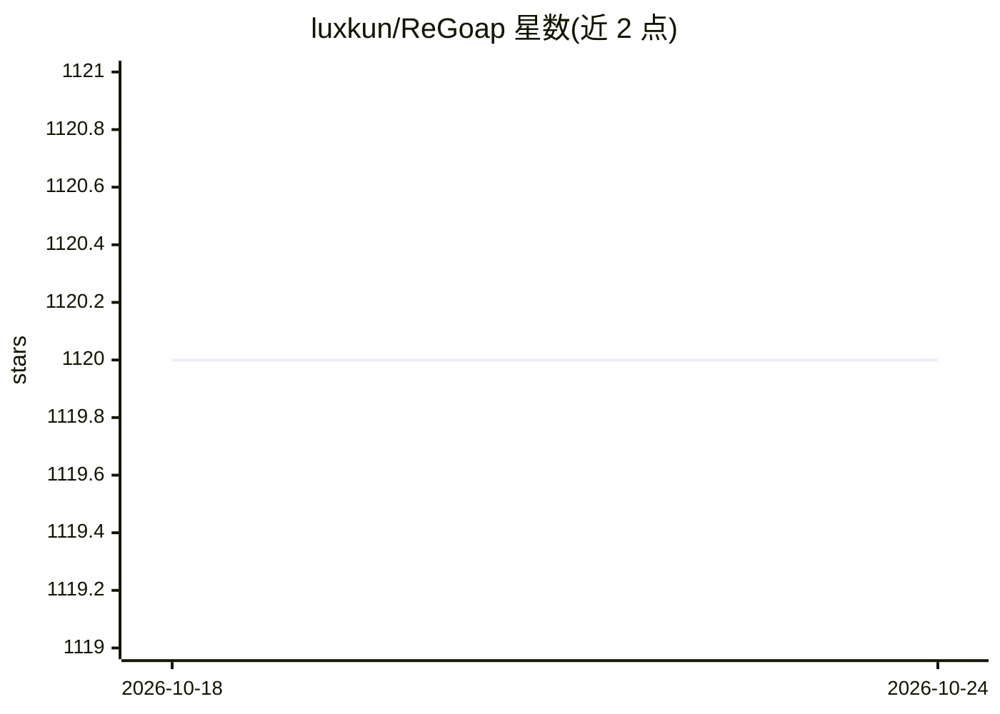

# luxkun/ReGoap

⭐ 1,121 · C# · Apache-2.0 · 推送 2026-04-21 · [GitHub](https://github.com/luxkun/ReGoap) · 个人维护

**给游戏开发者的通用 C# GOAP 规划库（Unity/Godot 适配）**

通用 C# 目标导向行动规划（GOAP）库，面向 Unity 与 Godot 游戏开发者：开发者定义世界状态事实、带前置条件/效果/成本的动作和带优先级的目标，规划器在每轮通过 A* 搜索选择目标并生成有效动作序列，运行时代理按序执行并在世界变化或失败时重规划。核心引擎无关（Core/Planner/Utilities），另提供 Unity 与 Godot 适配器及示例、调试支持。支持比较器条件（等于/不等/大于等于/小于等于）与确定性或加权随机的目标选择（含可复现种子）。集成流程为：定义事实与传感器、实现动作与目标、挂载代理与规划管理器，再在调试器与测试中验证行为。README 未给出具体安装命令。

## 筛选速览

| 维度 | 判定 | 备注 |
|---|---|---|
| AI 角色 | `ai-ecosystem` | LLM/agent 周边工具 |
| 许可风险 | `permissive` | Apache-2.0 |
| 部署形态 | `None` |  |
| 模型依赖 | — | README 未给出锁定关系 |
| 硬件要求 | — | 无带数字的原话,不猜 |
| 安装摩擦 | `low` | 无编译、无系统依赖或容器化 |
| 成熟度 | — | 结构信号不足 |

## 能力要点

- 引擎无关的 GOAP 规划核心（A* 搜索构建动作计划）
- Unity 与 Godot 适配器及各自示例/文档
- 比较器条件支持（Equal/NotEqual/GreaterOrEqual/LessOrEqual）
- 目标选择支持确定性优先级或加权随机（含确定性种子模式）

## 适用场景

- 为 NPC/敌人/模拟实体实现基于世界事实的决策与重规划
- 在不重写状态转移的情况下增删动作与目标
- 用计数逻辑（库存、资源、冷却阈值）驱动代理行为

## 场景标签

 · 领域:游戏开发/AI决策

## 证据(README 行号)

> L3: ReGoap is a generic C# GOAP (Goal Oriented Action Planning) library with Unity and Godot adapters.
> L5: It gives you a planner that chooses a goal, builds a valid action sequence to satisfy it, and lets your runtime exec

## 星数曲线

2026-10-18 1,120 → 2026-10-24 1,120（+0）

---
*卡片 v1 · prompt 1.4 · 生成 2026-10-21 · 置信度 mid · 依据 README sha `adff524c1e5b` · [字段定义](../../DATASET.md)*
