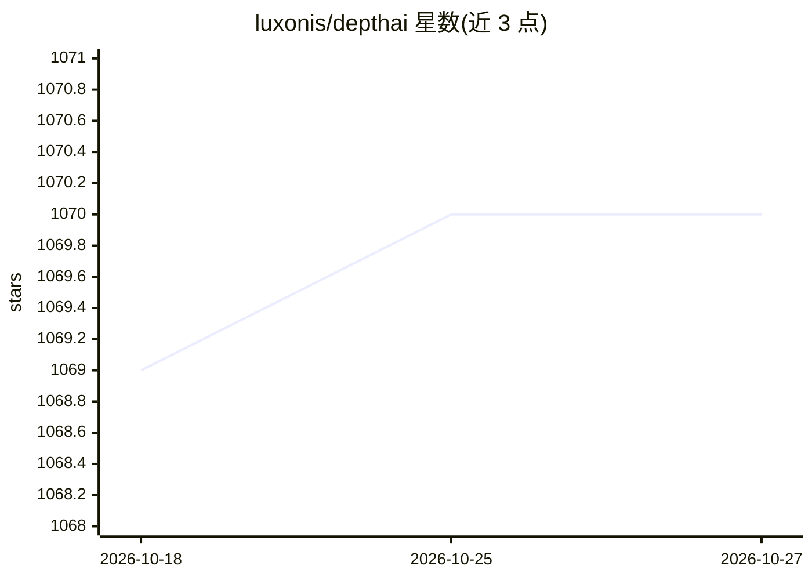

# luxonis/depthai

⭐ 1,070 · Python · 推送 2026-10-26 · [GitHub](https://github.com/luxonis/depthai) · [官网](https://docs.luxonis.com) · 组织维护

**Luxonis 平台开发入口：引导至官方文档**

该 README 仅为 Luxonis 平台的引导页，说明如何开始使用 Luxonis 平台的 Cloud、Software 与 Hardware 部分，并将旧 depthai 仓库内容指向 main 分支。README 本身未描述具体功能、安装命令或硬件要求，详细内容需查阅 Luxonis Docs 与 main 分支。DepthAI 项目本身是面向嵌入式空间视觉的软硬件生态，本页未展开。

## 筛选速览

| 维度 | 判定 | 备注 |
|---|---|---|
| AI 角色 | `ai-ecosystem` | LLM/agent 周边工具 |
| 许可风险 | `none` | — |
| 部署形态 | `None` |  |
| 模型依赖 | — | README 未给出锁定关系 |
| 硬件要求 | — | 无带数字的原话,不猜 |
| 安装摩擦 | `low` | 无编译、无系统依赖或容器化 |
| 成熟度 | — | 结构信号不足 |

## 能力要点

- 提供 Luxonis 官方文档入口
- 覆盖 Cloud、Software、Hardware 三部分指引
- 旧仓库内容迁移至 main 分支

## 适用场景

- 查找 Luxonis 平台的入门文档
- 定位旧 depthai 仓库内容

## 场景标签

`目标检测` · 领域:感知与多模态

## 证据(README 行号)

> L1: ## Looking to develop with Luxonis platform?
> L7: Visit our Docs to learn more about how to get started with Cloud, Software or Hardware parts of our Luxonis platform

## 星数曲线

2026-10-18 1,069 → 2026-10-27 1,070（+1）

---
*卡片 v1 · prompt 1.4 · 生成 2026-10-21 · 置信度 low · 依据 README sha `50da791cb592` · [字段定义](../../DATASET.md)*
