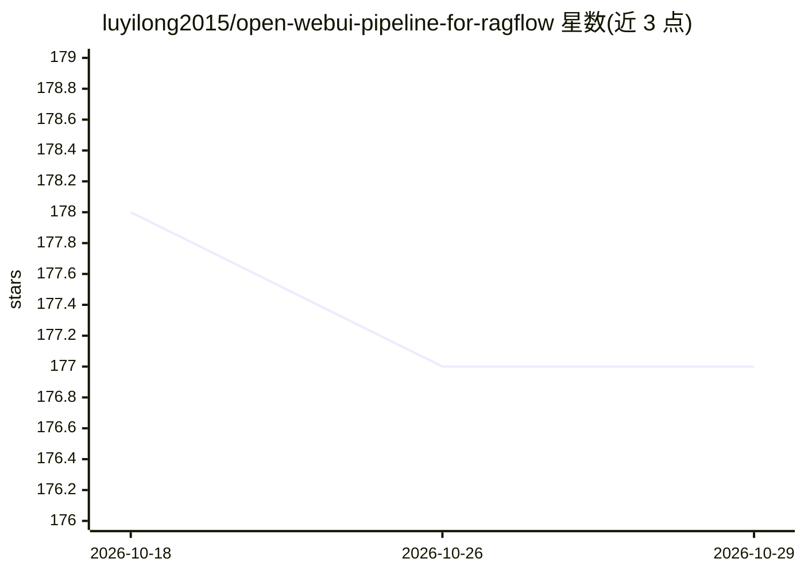

# luyilong2015/open-webui-pipeline-for-ragflow

⭐ 177 · Python · Unlicense · 推送 2026-10-28 · [GitHub](https://github.com/luyilong2015/open-webui-pipeline-for-ragflow) · 个人维护 · 中文 README

**将 RAGFlow 的 agent 接入 open-webui 对话界面的 pipeline 脚本**

一个 open-webui pipelines 集成脚本（单个 Python 文件）：通过 open-webui 的 pipelines 机制调用 RAGFlow 中已开发的 agent，使基于知识库的问答获得 open-webui 的对话交互界面。作者开发动机是 RAGFlow 自带界面便于调试但不适合终端用户使用。使用需先运行 open-webui 的 pipelines 项目并配置链接，再上传脚本并配置 API_KEY、AGENT_ID、HOST、PORT 四个参数；README 记录了与多版本 open-webui/RAGFlow 的适配测试历史。

## 筛选速览

| 维度 | 判定 | 备注 |
|---|---|---|
| AI 角色 | `ai-ecosystem` | LLM/agent 周边工具 |
| 许可风险 | `permissive` | Unlicense |
| 部署形态 | `None` |  |
| 模型依赖 | — | README 未给出锁定关系 |
| 硬件要求 | — | 无带数字的原话,不猜 |
| 安装摩擦 | `low` | 无编译、无系统依赖或容器化 |
| 成熟度 | — | 结构信号不足 |

## 能力要点

- 单个 Python pipeline 脚本，通过 pipelines 机制集成 RAGFlow agent
- 需配置 API_KEY/AGENT_ID/HOST/PORT 四个参数
- README 记录与 open-webui 0.5.20-0.6.34、ragflow 0.17.0-0.21.1 的适配历史

## 适用场景

- 在 open-webui 界面中使用 RAGFlow 知识库问答
- 为已部署的 RAGFlow agent 提供面向终端用户的对话界面

## 场景标签

`文档问答` · 领域:知识与检索

## 证据(README 行号)

> L13: 在我所负责的大模型项目中，ragflow的agent很好的处理了基于知识库的问答，但不幸的是，ragflow并没有提供一个很好的对话交互界面，自带的界面仅仅是便于调试，完全无法让用户使用，因此需要将ragflow的agent集成进
> L21: - 配置好链接后，将本项目的open-webui-pipeline-for-ragflow.py在open-webui中上传后，配置以下四个参数：

## 星数曲线

2026-10-18 178 → 2026-10-29 177（-1）

---
*卡片 v1 · prompt 1.4 · 生成 2026-10-23 · 置信度 high · 依据 README sha `8397a78c3931` · [字段定义](../../DATASET.md)*
