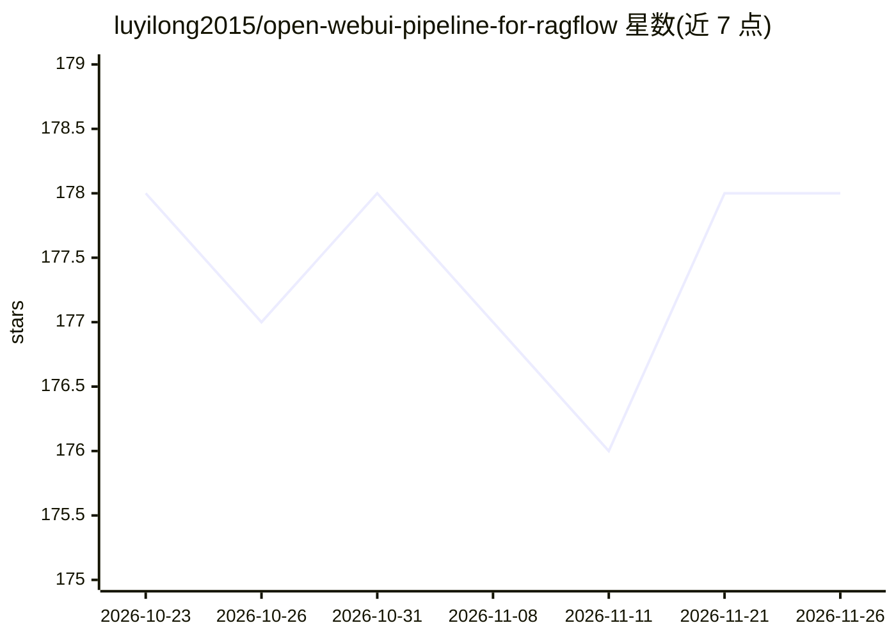

# luyilong2015/open-webui-pipeline-for-ragflow

⭐ 178 · Python · Unlicense · 推送 2026-10-28 · [GitHub](https://github.com/luyilong2015/open-webui-pipeline-for-ragflow) · 个人维护 · 中文 README

**为开发者提供在 open-webui 中调用 ragflow 知识库对话的管道脚本**

该项目提供 Python 管道脚本，利用 open-webui 的 pipelines 机制将 ragflow 的聊天助手接入 open-webui 对话界面，实现基于知识库的问答。支持流式回答、多轮上下文透传、思考过程折叠、答案末尾附参考来源文档链接。分两个版本：1.0.x 对接 ragflow v1.0.0-rc2+ 的聊天助手（当前维护），0.0.x 对接旧版 Agent API（仅存档）。部署依赖 Docker 运行 pipelines 容器，并需使用作者提供的打过补丁的 ragflow 镜像以修复思考混入正文的问题。无版权协议限制。

## 筛选速览

| 维度 | 判定 | 备注 |
|---|---|---|
| AI 角色 | `ai-ecosystem` | LLM/agent 周边工具 |
| 许可风险 | `permissive` | Unlicense |
| 部署形态 | `self-host` | docker 或自建部署 |
| 模型依赖 | — | README 未给出锁定关系 |
| 硬件要求 | — | 无带数字的原话,不猜 |
| 安装摩擦 | `low` | 无编译、无系统依赖或容器化 |
| 成熟度 | — | 结构信号不足 |

## 能力要点

- 通过 open-webui pipelines 上传脚本即可接入 ragflow 聊天助手
- 支持流式回答、多轮上下文透传与思考过程自动折叠
- 答案末尾附参考来源文档链接，可跳转 ragflow 文档页
- 提供针对 ragflow v1.0.0-rc2 思考混入正文问题的补丁镜像

## 适用场景

- 在 open-webui 界面中使用 ragflow 知识库问答
- 为已部署 ragflow 的项目补齐面向最终用户的对话界面
- 让回答展示引用来源文档链接

## 场景标签

`文档问答` `RAG` `聊天机器人` · 领域:对话与助手

## 证据(README 行号)

> L15: 在我所负责的大模型项目中，ragflow很好地处理了基于知识库的问答，但不幸的是，ragflow并没有提供一个很好的对话交互界面，自带的界面仅仅是便于调试，完全无法让用户使用，因此需要将ragflow集成进入一个比较成熟的对话界面
> L21: |**`ragflow_chat_pipeline.py`**（1.0.x，推荐）|**1.0.x**|v1.0.0-rc2+（Go 版）|聊天助手（Chat Assistant）|当前维护|

## 星数曲线

2026-10-23 178 → 2026-11-26 178（+0）

---
*卡片 v1 · prompt 1.4 · 生成 2026-11-26 · 置信度 high · 依据 README sha `60cf5bd5fc9a` · [字段定义](../../DATASET.md)*
