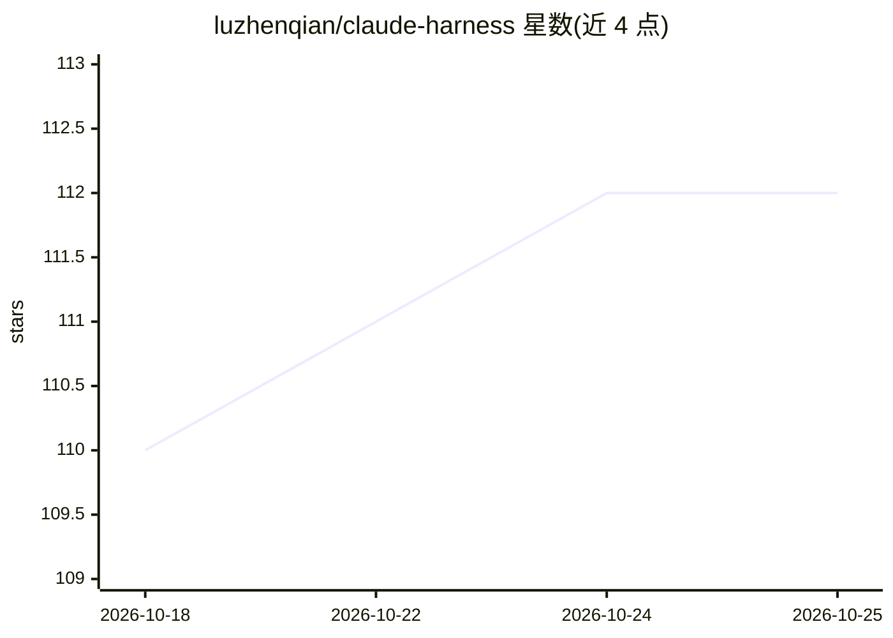

# luzhenqian/claude-harness

⭐ 112 · MDX · 推送 2026-05-21 · [GitHub](https://github.com/luzhenqian/claude-harness) · [官网](https://claude-harness.dev) · 个人维护 · 中文 README

**解构 Claude Code 的交互式源码分析学习平台**

基于 Next.js 的开源 Web 平台，用于浏览与理解 Claude Code（Anthropic 的 AI 编码 agent）内部实现。提供交互式代码浏览器（Shiki 高亮、FlexSearch 客户端全文搜索）、31 篇按子系统组织的 MDX 技术文章、35 个模块的统计可视化；数据生成管线将本地提供的 Claude Code 源码处理为结构化元数据。覆盖 1,902 个源文件、约 51 万行 TypeScript，支持英/中/日三语。需 Node.js 22+ 与 pnpm 从源码运行。

## 筛选速览

| 维度 | 判定 | 备注 |
|---|---|---|
| AI 角色 | `ai-knowledge` | 知识聚合/清单类 |
| 许可风险 | `none` | — |
| 部署形态 | `None` |  |
| 模型依赖 | — | README 未给出锁定关系 |
| 硬件要求 | — | 无带数字的原话,不猜 |
| 安装摩擦 | `low` | 无编译、无系统依赖或容器化 |
| 成熟度 | — | 结构信号不足 |

## 能力要点

- 交互式代码浏览器：语法高亮 + 客户端全文搜索
- 31 篇覆盖各子系统的引导式技术文章
- 35 个模块的文件数/行数统计与可视化
- pnpm generate 管线将源码处理为结构化元数据（文件树/模块统计/搜索索引）

## 适用场景

- 学习 Claude Code 的架构与 harness 工程模式
- 自建 AI agent 时参考其工具系统、权限与上下文管理设计
- 浏览和检索 Claude Code 源码的特定模块

## 场景标签

`教程课程` · 领域:学习与行业

## 证据(README 行号)

> L7: **Claude Harness** is an open-source platform for exploring and understanding the internals of Claude Code, Anthropi
> L15: - **Guided articles** that walk through each subsystem with real code references
> L39: 31 guided walkthroughs covering every major subsystem:

## 星数曲线

2026-10-18 110 → 2026-10-25 112（+2）

---
*卡片 v1 · prompt 1.4 · 生成 2026-10-23 · 置信度 high · 依据 README sha `c897f03df67b` · [字段定义](../../DATASET.md)*
