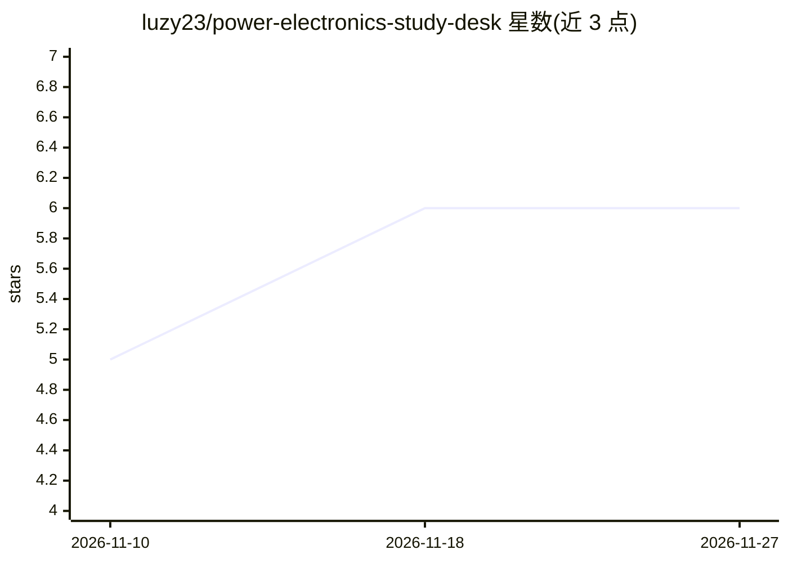

# luzy23/power-electronics-study-desk

⭐ 6 · JavaScript · MIT · 推送 2026-11-15 · [GitHub](https://github.com/luzy23/power-electronics-study-desk) · 个人维护 · 中文 README

**电力电子教材的本地 AI 学习工作台**

面向 Erickson《Fundamentals of Power Electronics》英文教材的本地网页学习工具：用 PyMuPDF 将自备 PDF 构建为按节切分、图表公式内嵌的数据，提供阅读器、读前预习、四栏精读、出题批改与错题本、费曼复述诊断、章节学习包、单词本与遗忘曲线复习、自定义学习计划等模块。所有 AI 内容通过用户自配的 OpenAI 兼容接口现生成，Python 本地服务运行于 127.0.0.1，需自备合法 PDF 且仅支持文字版。

## 筛选速览

| 维度 | 判定 | 备注 |
|---|---|---|
| AI 角色 | `ai-native` | 本体是模型或模型工具 |
| 许可风险 | `permissive` | MIT |
| 部署形态 | `library` | 以包/库形式分发 |
| 模型依赖 | locked-api |  |
| 硬件要求 | — | 无带数字的原话,不猜 |
| 安装摩擦 | `low` | 无编译、无系统依赖或容器化 |
| 成熟度 | — | 结构信号不足 |

## 能力要点

- 读前预习→精读→练习→费曼→学习包的完整学习流程
- PDF 解析按坐标裁剪图表公式并内嵌原文，字号/字体/行距可调
- 单词本自动收录查词并导出 Anki CSV，按遗忘曲线安排复习
- 高亮按内容哈希锚定，重建数据后自动归位

## 适用场景

- 配合自备教材 PDF 做章节级英文精读与习题练习
- 用费曼法让 AI 追问并生成诊断报告检验掌握程度
- 按开始/截止日期与目标章节自动生成周学习计划
- 建立带遗忘曲线复习的教材术语单词本

## 场景标签

`文档问答` · 领域:知识与检索

## 证据(README 行号)

> L4: > **读前预习 → 读中精读 → 读后练习 → 费曼复述 → 章节学习包 → 习题 / 复习计划**，每一步都由你配置的大模型（DeepSeek / OpenAI / Ollama 等）现生成。
> L22: |多模态识图|支持图片输入的模型（如 DeepSeek-V4.1-Flash）可直接读取本节插图/表格；设置里可关闭图片发送|

## 星数曲线

2026-11-10 5 → 2026-11-27 6（+1）

---
*卡片 v1 · prompt 1.4 · 生成 2026-11-20 · 置信度 high · 依据 README sha `f77c347b7d44` · [字段定义](../../DATASET.md)*
