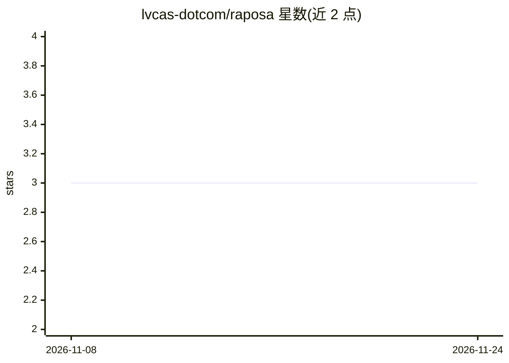

# lvcas-dotcom/raposa

⭐ 3 · Go · 推送 2026-11-11 · [GitHub](https://github.com/lvcas-dotcom/raposa) · 个人维护

**本地代码审查 CLI：对 PR diff 给出可验证证据的评审报告**

以 Go 编写的本地代码评审与评估工具，接收同一仓库的两个 commit，比对 diff 生成报告，报告记录完整 SHA、字面证据与 diff 行号，被丢弃的候选可追溯。无模型提供者时仅执行一条静态 Go 规则（识别 diff 中引入的 InsecureSkipVerify），作者声明这是受限基线而非通用逻辑评审。评审模型由操作者选择，通过外部进程 JSON 协议接入，内置仅接受 loopback 的 Ollama bridge，采用候选生成加反驳的两遍流程；限制包括最多 200 个变更文件、10 分钟总时限，许可证尚未确定。

## 筛选速览

| 维度 | 判定 | 备注 |
|---|---|---|
| AI 角色 | `ai-native` | 本体是模型或模型工具 |
| 许可风险 | `none` | — |
| 部署形态 | `None` |  |
| 模型依赖 | local-ok | 支持本地模型 |
| 硬件要求 | — | 无带数字的原话,不猜 |
| 安装摩擦 | `low` | 无编译、无系统依赖或容器化 |
| 成熟度 | `idea` | |

## 能力要点

- 证据级评审：字面证据与 diff 行号被核验，丢弃候选可追踪
- 无默认模型：操作者显式选择模型与提供者，无隐式凭据使用
- 内置本地 Ollama bridge（仅 loopback、拒 redirects），候选生成+反驳两遍流程
- 带评估模块：按人工标注计算精度、recall、重复与漏报

## 适用场景

- 对本地仓库的分支 diff 生成带证据引用的评审报告
- 在离线/本地环境下用 Ollama 模型做两遍式语义评审
- 用人工标注评估评审输出的精度与漏报

## 场景标签

`代码审查` · 领域:编码与开发

## 证据(README 行号)

> L5: Raposa é um revisor de código local e laboratório de avaliação, inspirado nas capacidades
> L34: Sem provedor, `review` executa **somente uma regra estática Go**: identifica
> L44: com JSON em stdin/stdout. Há um bridge para Ollama local, com duas passagens:

## 星数曲线

2026-11-08 3 → 2026-11-24 3（+0）

---
*卡片 v1 · prompt 1.4 · 生成 2026-11-21 · 置信度 high · 依据 README sha `f622c06a54d9` · [字段定义](../../DATASET.md)*
