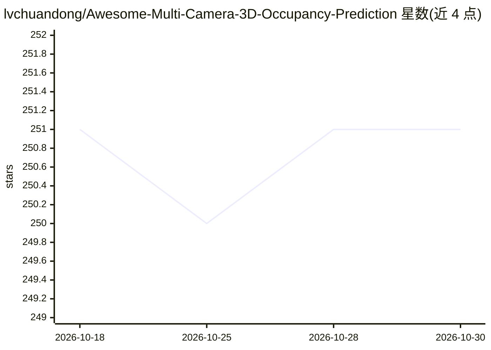

# lvchuandong/Awesome-Multi-Camera-3D-Occupancy-Prediction

⭐ 251 · MIT · 推送 2026-03-04 · [GitHub](https://github.com/lvchuandong/Awesome-Multi-Camera-3D-Occupancy-Prediction) · 个人维护 · 中文 README

**多相机 3D 占用预测论文与代码的策展清单**

按会议与年份组织（CVPR/ICCV/ECCV/AAAI/ICRA/NeurIPS/期刊/arXiv）整理多相机 3D 占用预测方向的论文条目，每条标注发表时间、标题及可用的 paper/github/知乎/B站/官网链接，覆盖 TPVFormer、SurroundOcc、GaussianFormer、SparseOcc 等工作，条目延伸至 2026 年。面向自动驾驶感知方向的科研人员，用于跟踪该领域论文与开源代码。仓库仅含列表内容，不提供安装或运行流程。

## 筛选速览

| 维度 | 判定 | 备注 |
|---|---|---|
| AI 角色 | `ai-knowledge` | 知识聚合/清单类 |
| 许可风险 | `permissive` | MIT |
| 部署形态 | `None` |  |
| 模型依赖 | — | README 未给出锁定关系 |
| 硬件要求 | — | 无带数字的原话,不猜 |
| 安装摩擦 | `low` | 无编译、无系统依赖或容器化 |
| 成熟度 | — | 结构信号不足 |

## 能力要点

- 按顶会与年份分类组织的论文条目列表
- 多数条目附 paper 与 github 代码链接
- 部分条目附知乎/B站/官网链接
- 收录延伸至 2026 年 2 月的最新条目

## 适用场景

- 查找多相机 3D 占用预测方向的论文与开源代码
- 按会议年份跟踪该领域的最新研究进展
- 对比 TPVFormer、SurroundOcc 等方法的开源实现

## 场景标签

`精选清单` · 领域:学习与行业

## 证据(README 行号)

> L1: # Awesome-Multi-Camera-3D-Occupancy-Prediction
> L3: ### CVPR
> L107: ### Arxiv

## 星数曲线

2026-10-18 251 → 2026-10-30 251（+0）

---
*卡片 v1 · prompt 1.4 · 生成 2026-10-22 · 置信度 high · 依据 README sha `5f682481fe73` · [字段定义](../../DATASET.md)*
