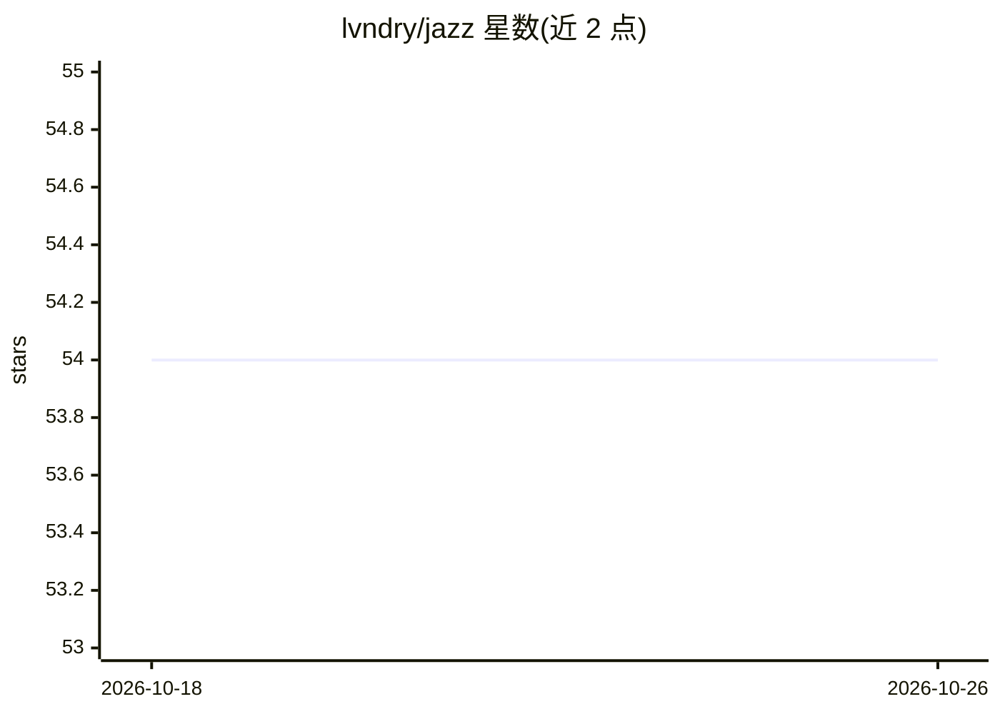

# lvndry/jazz

⭐ 54 · TypeScript · MIT · 推送 2026-10-25 · [GitHub](https://github.com/lvndry/jazz) · [官网](https://jazz-cli.vercel.app/) · 个人维护

**TypeScript agent harness：用 JSON 定义 agent 并在终端/脚本/聊天平台运行**

Jazz 是用 Effect/TypeScript 编写的 agent harness，提供运行循环、护栏与多种交付面（surfaces）。用户在一个 JSON 文件中定义主模型、伴随模型、人格、工具与权限，即可在终端 REPL、脚本、定时任务、GitHub Action、Telegram/Discord/iMessage/WhatsApp 机器人等环境运行同一 agent，共享同一记忆。开箱支持文件、git、web 操作，可连接收件箱、Obsidian 库、搜索服务，其余通过 MCP 接入。支持 23 个 provider，含 ollama/llama.cpp/vllm/sglang 自托管后端；提供自包含二进制与 npm 两种安装方式。

## 筛选速览

| 维度 | 判定 | 备注 |
|---|---|---|
| AI 角色 | `ai-ecosystem` | LLM/agent 周边工具 |
| 许可风险 | `permissive` | MIT |
| 部署形态 | `self-host` | docker 或自建部署 |
| 模型依赖 | local-ok | 支持本地模型 |
| 硬件要求 | — | 无带数字的原话,不猜 |
| 安装摩擦 | `low` | 无编译、无系统依赖或容器化 |
| 成熟度 | — | 结构信号不足 |

## 能力要点

- 一个 JSON 文件定义 agent（模型、人格、工具、权限）
- 同一 agent 可运行于终端、脚本、定时任务、GitHub Action 与多种聊天机器人
- 支持 23 个 provider，含 ollama/llama.cpp/vllm/sglang 自托管模型
- 按能力组合多模型：不同媒介（图像/音频/视频）绑定不同伴随模型

## 适用场景

- 在终端里跑一个能操作文件、git 和 web 的无人值守 agent
- 让机器人定时执行工作流或在 GitHub PR 上做审查
- 通过 Telegram/Discord 与自有 agent 对话并在聊天中审批权限请求

## 场景标签

`Agent 框架` · 领域:Agent 开发

## 证据(README 行号)

> L9: Jazz is an agent harness: the loop, guardrails, and surfaces that turn a model into an
> L24: OpenRouter, plus `ollama`, `llama.cpp`, `vllm`, and `sglang` for self-hosted models with no API key unless the serv

## 星数曲线

2026-10-18 54 → 2026-10-26 54（+0）

---
*卡片 v1 · prompt 1.4 · 生成 2026-10-24 · 置信度 mid · 依据 README sha `0e203ba629c0` · [字段定义](../../DATASET.md)*
