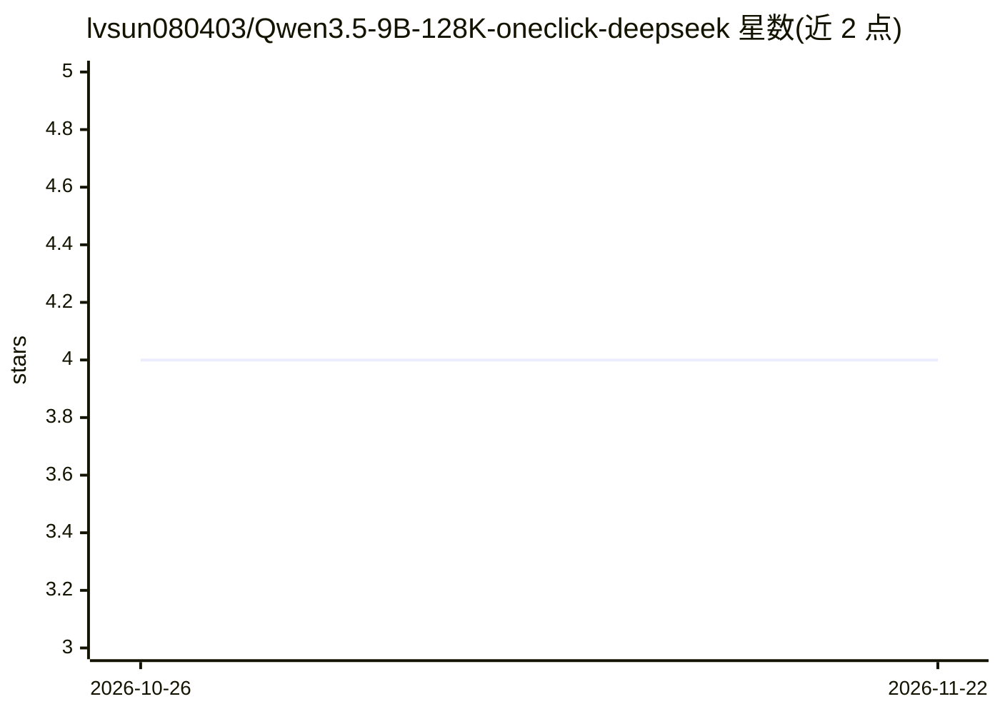

# lvsun080403/Qwen3.5-9B-128K-oneclick-deepseek

⭐ 4 · PowerShell · MIT · 推送 2026-10-23 · [GitHub](https://github.com/lvsun080403/Qwen3.5-9B-128K-oneclick-deepseek) · 个人维护 · 中文 README

**给 Windows 用户一键部署 128K 上下文的 Qwen3.5-9B 本地推理服务**

一个 Windows 打包仓库：双击 start-qwen.bat 后，PowerShell 脚本自动完成环境自检、下载 llama.cpp CUDA 构建引擎与 unsloth 量化的 Qwen3.5-9B GGUF 权重、校验 GPU 实际生效、启动服务并自测，最终暴露标准 OpenAI 兼容端点。不需要安装 CUDA Toolkit 或 Python，支持断点续传与幂等重跑。显存估算表给出 8 GB 卡 32K / 12 GB 卡 128K 两档配置，附带 DeepSeek Harness 启停插件。

## 筛选速览

| 维度 | 判定 | 备注 |
|---|---|---|
| AI 角色 | `ai-ecosystem` | LLM/agent 周边工具 |
| 许可风险 | `permissive` | MIT |
| 部署形态 | `desktop` | 安装包/桌面程序 |
| 模型依赖 | local-ok | 支持本地模型 |
| 硬件要求 | `gpu-8g` | |
| 安装摩擦 | `medium` | 含编译或系统依赖之一 |
| 成熟度 | — | 结构信号不足 |

## 能力要点

- 双击 bat 完成下载、校验、启动、自测的全流程自动化
- 自带 llama.cpp b11669 CUDA 构建，无需安装 CUDA Toolkit 与 Python
- 启动前强制 --list-devices 验证 CUDA0，防止静默回落 CPU
- 暴露 OpenAI 兼容端点 /v1/chat/completions，可接入任意客户端

## 适用场景

- 在本地 Windows 显卡上离线跑大模型推理
- 给已有客户端提供本地 OpenAI 兼容 API
- 在 12 GB 显卡上处理超长上下文文档

## 场景标签

`推理引擎` · 领域:训练与推理

## 证据(README 行号)

> L23: - 自带推理引擎（llama.cpp b11669 · CUDA 13.4），**不用装 CUDA Toolkit、不用 Python**
> L26: - 起来就是一个**标准 OpenAI 接口**（`/v1/chat/completions`），能直接喂给任何客户端
> L177: A one-click Windows bundle for **Qwen3.5-9B (UD-Q4_K_XL)** on llama.cpp. No CUDA Toolkit, no Python, no compilatio

## 星数曲线

2026-10-26 4 → 2026-11-22 4（+0）

---
*卡片 v1 · prompt 1.4 · 生成 2026-11-21 · 置信度 high · 依据 README sha `dbb0f9732952` · [字段定义](../../DATASET.md)*
