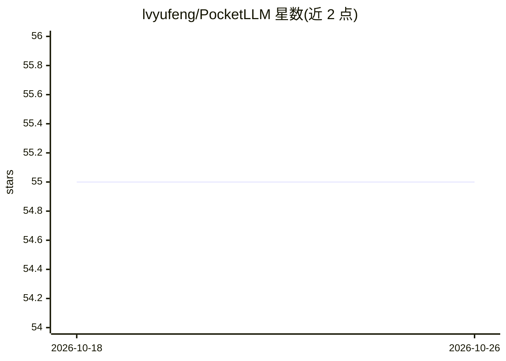

# lvyufeng/PocketLLM

⭐ 55 · Python · MIT · 推送 2026-10-20 · [GitHub](https://github.com/lvyufeng/PocketLLM) · [官网](https://lvyufeng.github.io/PocketLLM/) · 个人维护 · 中文 README

**单设备运行 LLM 的推理引擎，面向消费级与边缘硬件**

C++ 核（libpocketllm.so）在单块 CPU/GPU/边缘板/手机上运行大模型：读取 GGUF、自带 BPE 分词、前向与解码，支持 f16 与 q2_k–q6_k、iq2_xxs/iq2_xs 打包量化格式，贪心解码逐 token 对齐 llama.cpp。设备路径覆盖 CPU(AVX2)、单张 NVIDIA(sm_75+)、RDK S600（Horizon BPU，预编译图）与 Orange Pi AIpro（Ascend 310B）。设计规则是放不下就进一步量化，不做 offload 与多卡切分。另含 qwen3vl 视觉与 qwen3a 语音两条多模态路径及 OpenAI 兼容 HTTP 服务；Python 包为宿主侧规格与 numpy 参考实现，不直接运行模型。

## 筛选速览

| 维度 | 判定 | 备注 |
|---|---|---|
| AI 角色 | `ai-ecosystem` | LLM/agent 周边工具 |
| 许可风险 | `permissive` | MIT |
| 部署形态 | `library` | 以包/库形式分发 |
| 模型依赖 | — | README 未给出锁定关系 |
| 硬件要求 | — | 无带数字的原话,不猜 |
| 安装摩擦 | `high` | 编译与系统依赖俱全 |
| 成熟度 | `idea` | |

## 能力要点

- C 核在 CPU/CUDA 上逐 token 对齐 llama.cpp，支持 7 种打包量化格式
- 单进程独占单设备，放不下则沿 Q4→Q2→IQ2→IQ1→ternary 阶梯量化，不 offload 不切卡
- 支持 Ascend 310B 与 Horizon Nash BPU 边缘板路径
- 提供 OpenAI 兼容 HTTP 服务与 CLI（run/serve 等 6 命令）

## 适用场景

- 在单张老显卡或边缘板上离线运行 Qwen3 等模型
- 通过 OpenAI 兼容接口在本地提供推理服务
- 对量化后模型做极限压缩以适配小内存设备

## 场景标签

`推理引擎` `模型量化` · 领域:训练与推理

## 证据(README 行号)

> L10: Run a large language model on **one accelerator** — a single GPU, an edge board, the phone in your
> L16: Qwen3, on four accelerator classes, through one engine. The C core (`src/`, `libpocketllm.so`) is
> L129: |`src/` — the C++ engine (`libpocketllm.so`)|**Runs Qwen3-0.6B and 1.7B in `f16` and the seven packed formats `q2_

## 星数曲线

2026-10-18 55 → 2026-10-26 55（+0）

---
*卡片 v1 · prompt 1.4 · 生成 2026-10-24 · 置信度 high · 依据 README sha `46bf4c36e4be` · [字段定义](../../DATASET.md)*
