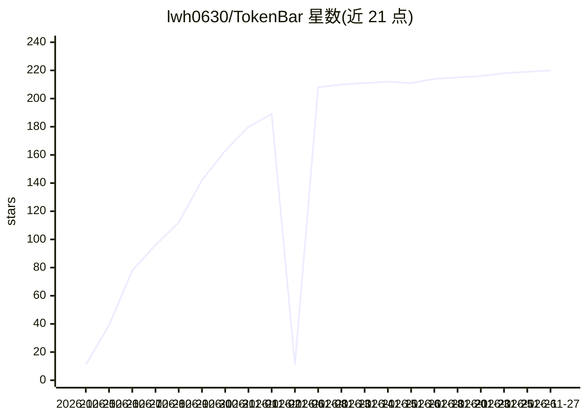

# lwh0630/TokenBar

⭐ 220 · Dart · MIT · 推送 2026-11-24 · [GitHub](https://github.com/lwh0630/TokenBar) · 个人维护 · 中文 README

**跨平台 AI 用量配额监控应用，聚合 57 项服务的额度与余额**

用 Flutter 构建的桌面与移动应用，从用户设备直接查询各服务商接口，展示剩余配额、余额、重置倒计时与用量速度；支持 5 小时/周/月/按模型窗口、用量历史图表、低额度通知、托盘图标与 Android 桌面小组件。读取凭据的方式包括复用本机官方客户端登录（只读）、粘贴 API key 或 Cookie；可选自托管同步服务器只接收用量快照，不接收凭据。部分非公开接口可能随服务商变更而失效。

## 筛选速览

| 维度 | 判定 | 备注 |
|---|---|---|
| AI 角色 | `ai-ecosystem` | LLM/agent 周边工具 |
| 许可风险 | `permissive` | MIT |
| 部署形态 | `desktop` | 安装包/桌面程序 |
| 模型依赖 | — | README 未给出锁定关系 |
| 硬件要求 | — | 无带数字的原话,不猜 |
| 安装摩擦 | `low` | 无编译、无系统依赖或容器化 |
| 成熟度 | — | 结构信号不足 |

## 能力要点

- 覆盖 57 项服务：订阅、API key、编码套餐、自托管网关等四类接入
- 凭据只读本机官方客户端登录或粘贴 key/Cookie，不代登录、不上传凭据
- 托盘双条图标、用量历史图表、低额度阈值通知与 Android 小组件
- 提供 tokenbar usage CLI 与可选自托管同步服务器

## 适用场景

- 在同一界面查看 Codex、Claude、Cursor 等多个订阅的剩余额度
- 按阈值设置低额度提醒，掌握重置时间
- 在手机上查看电脑推送的用量快照
- 用 CLI 以 JSON 输出用量数据做脚本处理

## 场景标签

`LLM 可观测性` · 领域:评测与运维

## 证据(README 行号)

> L6: An open-source, cross-platform monitor for AI usage limits, balances and reset times.
> L22: - **See everything in one place.** Codex, Claude, Cursor, OpenRouter, DeepSeek, z.ai and 46 more: remaining quota, 
> L23: - **Nothing sits in the middle.** The app queries each provider's own endpoint from your device. The optional sync 

## 星数曲线

2026-10-25 11 → 2026-11-27 220（+209）

---
*卡片 v1 · prompt 1.4 · 生成 2026-11-26 · 置信度 mid · 依据 README sha `32eebb2c4249` · [字段定义](../../DATASET.md)*
