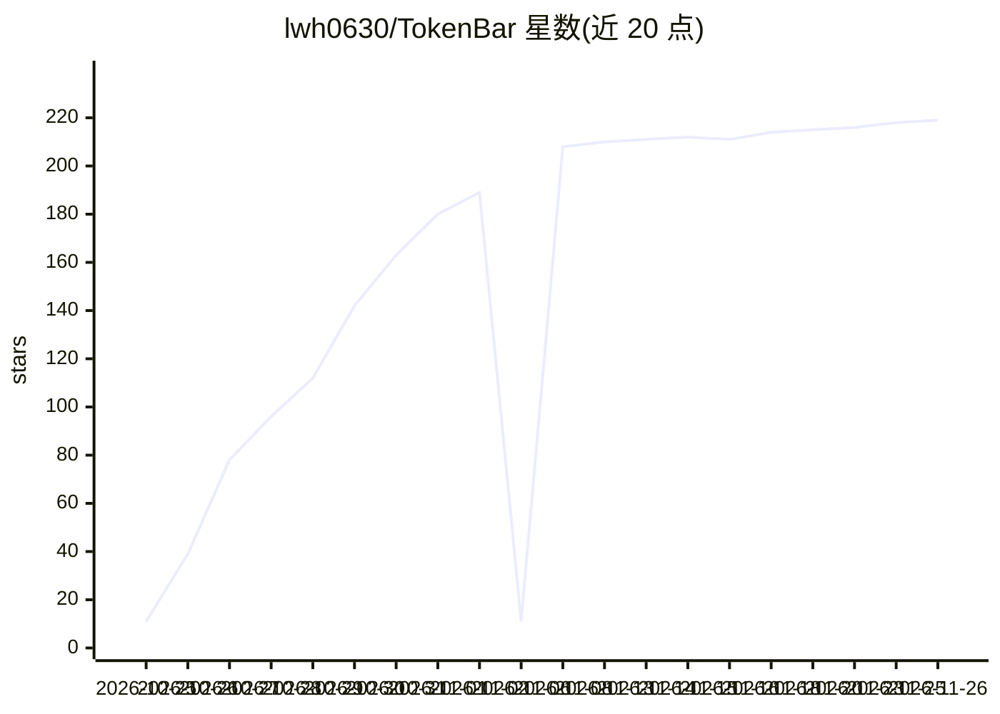

# lwh0630/TokenBar

⭐ 219 · Dart · MIT · 推送 2026-11-24 · [GitHub](https://github.com/lwh0630/TokenBar) · 个人维护 · 中文 README

**跨平台 AI 服务配额监控应用：聚合多平台用量与余额**

基于 Flutter 构建的桌面与移动应用，聚合查看 57 个 AI 服务的剩余配额、余额、重置倒计时与用量速率。读取方式有三种：复用桌面端官方 CLI/应用的已有登录（只读）、粘贴 API key 或 Cookie、可选的自托管同步服务器只接收用量快照不接收凭据。支持托盘图标、用量历史、低配额通知、手机小组件与 JSON 输出的 CLI。部分接入依赖非公开端点，可能随服务商变更而失效。

## 筛选速览

| 维度 | 判定 | 备注 |
|---|---|---|
| AI 角色 | `ai-ecosystem` | LLM/agent 周边工具 |
| 许可风险 | `permissive` | MIT |
| 部署形态 | `desktop` | 安装包/桌面程序 |
| 模型依赖 | locked-api |  |
| 硬件要求 | — | 无带数字的原话,不猜 |
| 安装摩擦 | `low` | 无编译、无系统依赖或容器化 |
| 成熟度 | — | 结构信号不足 |

## 能力要点

- 聚合 57 个服务的配额、余额、重置倒计时与线性速率对比
- 三种接入方式：本地登录只读复用、API key/Cookie、自托管同步服务器
- 支持中英双语界面、托盘面板、Android 桌面小组件与 CLI JSON 输出
- MIT 许可，覆盖订阅、API key、Coding plan、自托管网关等多类服务

## 适用场景

- 在同一界面查看 Codex、Claude、Cursor 等订阅的剩余配额与重置时间
- 监控多个 API 平台账户的余额与近期花费
- 在手机或浏览器查看自托管同步过来的用量快照
- 低配额时收到阈值告警通知

## 场景标签

 · 领域:开发者工具/AI 服务监控

## 证据(README 行号)

> L6: An open-source, cross-platform monitor for AI usage limits, balances and reset times.
> L22: - **See everything in one place.** Codex, Claude, Cursor, OpenRouter, DeepSeek, z.ai and 46 more: remaining quota, 
> L23: - **Nothing sits in the middle.** The app queries each provider's own endpoint from your device. The optional sync 

## 星数曲线

2026-10-25 11 → 2026-11-26 219（+208）

---
*卡片 v1 · prompt 1.4 · 生成 2026-11-25 · 置信度 low · 依据 README sha `1419f62016e0` · [字段定义](../../DATASET.md)*
