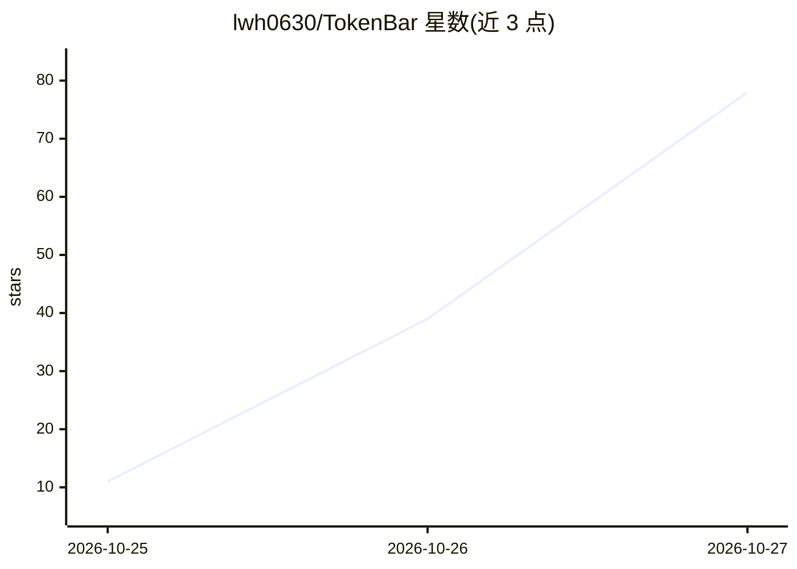

# lwh0630/TokenBar

⭐ 78 · Dart · MIT · 推送 2026-10-26 · [GitHub](https://github.com/lwh0630/TokenBar) · 个人维护 · 中文 README

**跨平台 AI 配额/余额监控应用：聚合显示 50 个服务的用量限额**

用 Flutter 构建的开源跨平台桌面与移动应用，监控 Codex、Claude、Cursor、OpenRouter 等 50 个 AI 服务的剩余配额、余额、重置倒计时与用量历史。凭据仅存本机安全存储，桌面端可只读复用官方 CLI/应用的本地登录；提供托盘图标、低配额通知、Android 小组件、CLI 输出与可选自托管同步服务器（只收用量快照）。Linux/iOS 为实验性，iOS IPA 未签名需自行侧载。

## 筛选速览

| 维度 | 判定 | 备注 |
|---|---|---|
| AI 角色 | `ai-enhanced` | 去掉 AI 部分产品仍成立 |
| 许可风险 | `permissive` | MIT |
| 部署形态 | `desktop` | 安装包/桌面程序 |
| 模型依赖 | locked-api |  |
| 硬件要求 | — | 无带数字的原话,不猜 |
| 安装摩擦 | `low` | 无编译、无系统依赖或容器化 |
| 成熟度 | `idea` | |

## 能力要点

- 覆盖 50 个 AI 服务：订阅登录、API key、Cookie 三种读取方式
- 凭据留在设备安全存储，同步服务器仅收用量快照
- 桌面托盘双条图标、通知、用量历史与 CLI（JSON 输出）
- Windows/macOS/Android 提供安装包，Linux/iOS 为实验性

## 适用场景

- 在一个面板里查看多个 AI 订阅和 API 服务的剩余配额与余额
- 在配额将耗尽或重置时收到提醒
- 手机上通过自建同步服务器查看 PC 推送的用量快照

## 场景标签

 · 领域:AI 用量监控/桌面与移动工具

## 证据(README 行号)

> L6: An open-source, cross-platform monitor for AI usage limits, balances and reset times.
> L22: - **See everything in one place.** Codex, Claude, Cursor, OpenRouter, DeepSeek, z.ai and 44 more: remaining quota, 

## 星数曲线

2026-10-25 11 → 2026-10-27 78（+67）

---
*卡片 v1 · prompt 1.4 · 生成 2026-10-25 · 置信度 mid · 依据 README sha `15be848ab5f3` · [字段定义](../../DATASET.md)*
