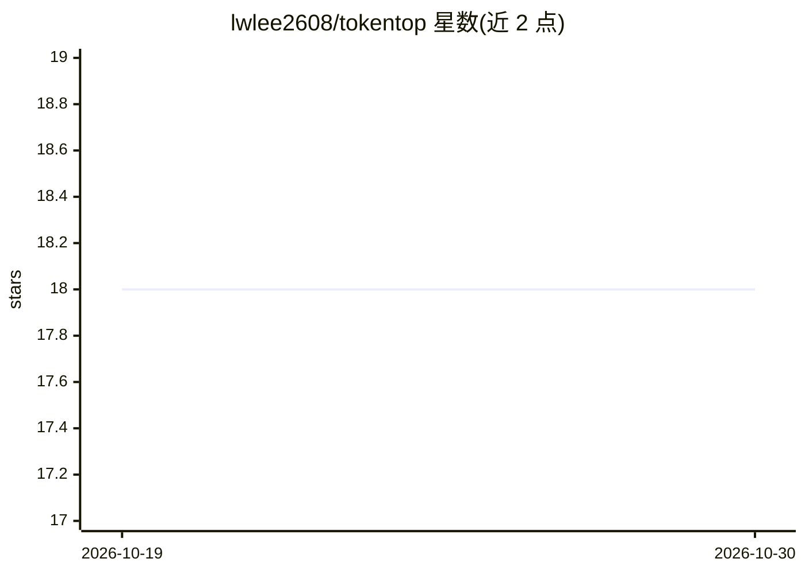

# lwlee2608/tokentop

⭐ 18 · Go · MIT · 推送 2026-10-18 · [GitHub](https://github.com/lwlee2608/tokentop) · 个人维护

**终端仪表盘：实时监控 Claude Code/Codex/OpenRouter 的 API 用量**

用 Go 编写的 TUI（bubbletea）仪表盘，实时读取 Claude Code、OpenAI Codex、OpenRouter、VelociRouter 四类 AI 编码服务的 API 用量数据。凭据自动从 Claude Code 的 macOS Keychain 或 ~/.claude/.credentials.json、Codex 的 ~/.codex/auth.json 检测，OpenRouter/VelociRouter 通过环境变量 API key 接入（活动与余额明细需 management key）。提供 curl 安装脚本、Homebrew 与源码编译三种安装方式。

## 筛选速览

| 维度 | 判定 | 备注 |
|---|---|---|
| AI 角色 | `ai-ecosystem` | LLM/agent 周边工具 |
| 许可风险 | `permissive` | MIT |
| 部署形态 | `None` |  |
| 模型依赖 | locked-api |  |
| 硬件要求 | — | 无带数字的原话,不猜 |
| 安装摩擦 | `medium` | 含编译或系统依赖之一 |
| 成熟度 | — | 结构信号不足 |

## 能力要点

- 实时监控 Claude Code / Codex / OpenRouter / VelociRouter 四个服务的 API 用量
- 自动检测 Claude Code 与 Codex 的本地凭据文件
- 支持 Homebrew、curl 脚本、源码 make install 三种安装途径

## 适用场景

- 跟踪多个 AI 编码助手的 token 消耗与余额
- 在终端查看 Claude Code / Codex 会话用量
- 配置 API key 后监控 OpenRouter 账户活动与额度

## 场景标签

`LLM 可观测性` · 领域:评测与运维

## 证据(README 行号)

> L9: A terminal dashboard for monitoring your API usage in real time. Supports Claude Code, OpenAI Codex, OpenRouter, and
> L37: - **Claude**: An active Claude Code session — credentials are picked up automatically from the macOS Keychain (`Cla

## 星数曲线

2026-10-19 18 → 2026-10-30 18（+0）

---
*卡片 v1 · prompt 1.4 · 生成 2026-10-29 · 置信度 high · 依据 README sha `e2db51f70b02` · [字段定义](../../DATASET.md)*
