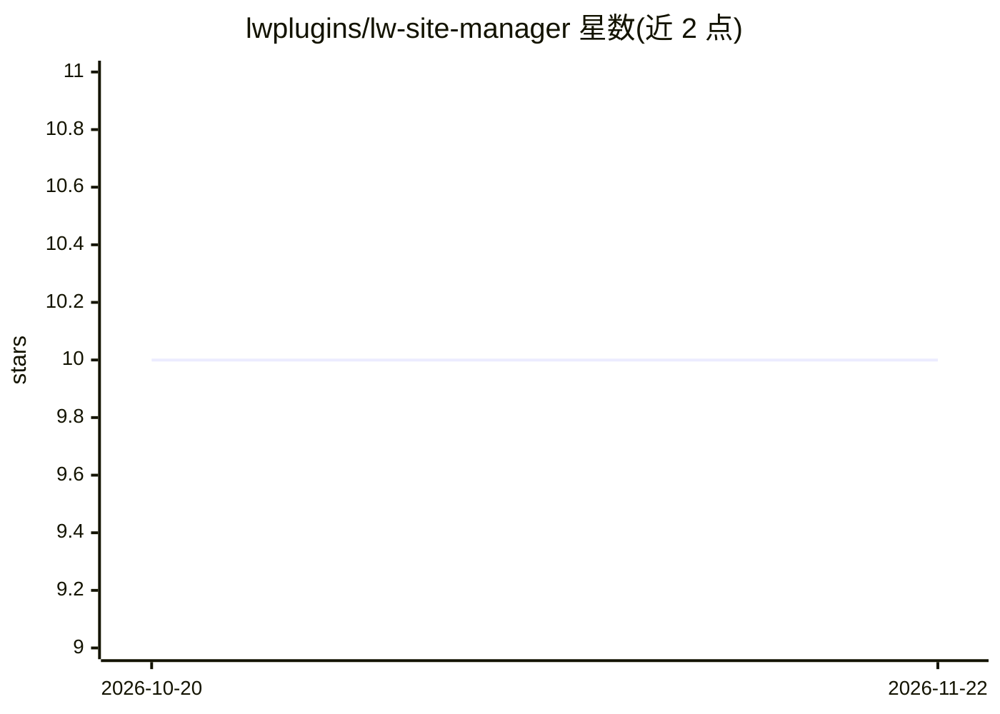

# lwplugins/lw-site-manager

⭐ 10 · PHP · GPL-2.0 · 推送 2026-11-09 · [GitHub](https://github.com/lwplugins/lw-site-manager) · 组织维护

**面向 AI Agent 的 WordPress 站点维护插件（190 个 abilities + MCP 服务器）**

基于 WordPress Abilities API 的站点维护插件，注册 190 个 abilities（启用 WooCommerce 时），覆盖更新、插件/主题/文章/页面/用户/评论/媒体管理、备份、数据库优化、缓存清理与健康诊断等站点运维操作，另含订单、商品、运费、报表等 WooCommerce 能力。通过 REST API、PHP 调用或内置 MCP 服务器（v1.2.0 起）供 AI agent 作为工具调用，需管理员 Application Password 认证。要求 PHP 8.2+ 与 WordPress 6.9+。

## 筛选速览

| 维度 | 判定 | 备注 |
|---|---|---|
| AI 角色 | `ai-enhanced` | 去掉 AI 部分产品仍成立 |
| 许可风险 | `viral` | GPL-2.0 |
| 部署形态 | `None` |  |
| 模型依赖 | — | README 未给出锁定关系 |
| 硬件要求 | — | 无带数字的原话,不猜 |
| 安装摩擦 | `low` | 无编译、无系统依赖或容器化 |
| 成熟度 | — | 结构信号不足 |

## 能力要点

- 注册 190 个 abilities，覆盖站点维护与 WooCommerce 运营操作
- 内置 MCP 服务器（默认开启），供 Claude Code、Claude Desktop、ChatGPT 等客户端直接连接
- REST API（HTTP）与 PHP（wp_get_ability）两种调用方式
- 危险操作需确认标志（confirm_delete/confirm_refund 等），订单修改带锁定与重新计算机制

## 适用场景

- 让 AI agent 检查并安全地批量更新 WordPress 站点的核心/插件/主题
- 通过 MCP 客户端管理 WooCommerce 订单、商品与库存
- 用 REST API 脚本化执行备份、数据库清理与缓存刷新

## 场景标签

 · 领域:Web 开发/站点运维工具

## 证据(README 行号)

> L3: WordPress Site Manager using the Abilities API - AI-ready site maintenance with a built-in MCP server.
> L29: The plugin currently registers **190 abilities** (with WooCommerce active). All slugs use the `site-manager/` names
> L227: This plugin is designed for AI agent integration via:

## 星数曲线

2026-10-20 10 → 2026-11-22 10（+0）

---
*卡片 v1 · prompt 1.4 · 生成 2026-11-19 · 置信度 high · 依据 README sha `acc41b59e4dd` · [字段定义](../../DATASET.md)*
