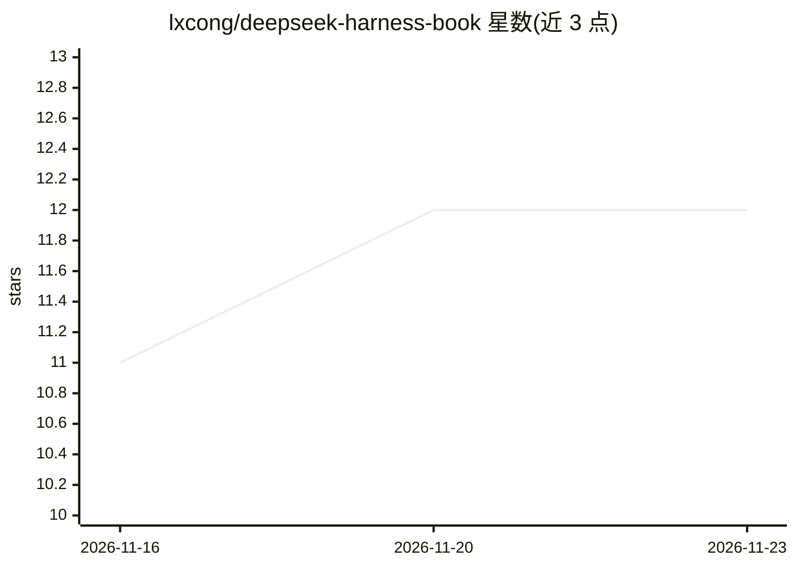

# lxcong/deepseek-harness-book

⭐ 12 · CC-BY-SA-4.0 · 推送 2026-08-13 · [GitHub](https://github.com/lxcong/deepseek-harness-book) · 个人维护 · 中文 README

**面向工程师的 DeepSeek Harness 源码解读开源书**

一本用 mdBook 构建的中文开源书，逐层解读 DeepSeek Harness（dsh）的源码实现：Cordis 插件框架、Agent 主循环、事件日志会话模型、工具系统、模型层与多智能体扩展等十个部分。面向正在学习 Agent Harness 工程实现的工程师，关注架构设计动机而非功能使用。可通过 mdBook 在线阅读或直接读 markdown，建议搭配 git clone 上游源码对照阅读。基于 developer preview 阶段源码写作，细节可能与最新版本不一致。

## 筛选速览

| 维度 | 判定 | 备注 |
|---|---|---|
| AI 角色 | `ai-knowledge` | 知识聚合/清单类 |
| 许可风险 | `viral` | CC-BY-SA-4.0 |
| 部署形态 | `None` |  |
| 模型依赖 | — | README 未给出锁定关系 |
| 硬件要求 | — | 无带数字的原话,不猜 |
| 安装摩擦 | `low` | 无编译、无系统依赖或容器化 |
| 成熟度 | `idea` | |

## 能力要点

- 十个部分覆盖插件框架、Agent 循环、事件日志、工具系统、模型层与多智能体
- mdBook 构建，支持 mdbook serve 在线阅读与 markdown 直接阅读
- 每章末「延伸阅读」列出对应源码路径便于对照
- 以 CC BY-SA 4.0 发布

## 适用场景

- 学习 Agent Harness 的工程实现与架构设计
- 对照阅读 deepseek-harness 源码时查阅章节解读
- 了解 monorepo 插件化架构与事件日志会话建模方式

## 场景标签

`教程课程` · 领域:学习与行业

## 证据(README 行号)

> L1: # DeepSeek Harness 源码解读
> L5: 本书面向正在学习 Agent Harness 工程实现的工程师，逐层解读 DeepSeek Harness（`dsh`）的源码：它如何用「everything is a plugin」的架构组织一个 50+ 包的 monorepo，
> L11: - 在线阅读：用 mdBook 构建——`mdbook serve` 后访问 http://localhost:3000

## 星数曲线

2026-11-16 11 → 2026-11-23 12（+1）

---
*卡片 v1 · prompt 1.4 · 生成 2026-11-18 · 置信度 high · 依据 README sha `a4fe57a46a36` · [字段定义](../../DATASET.md)*
