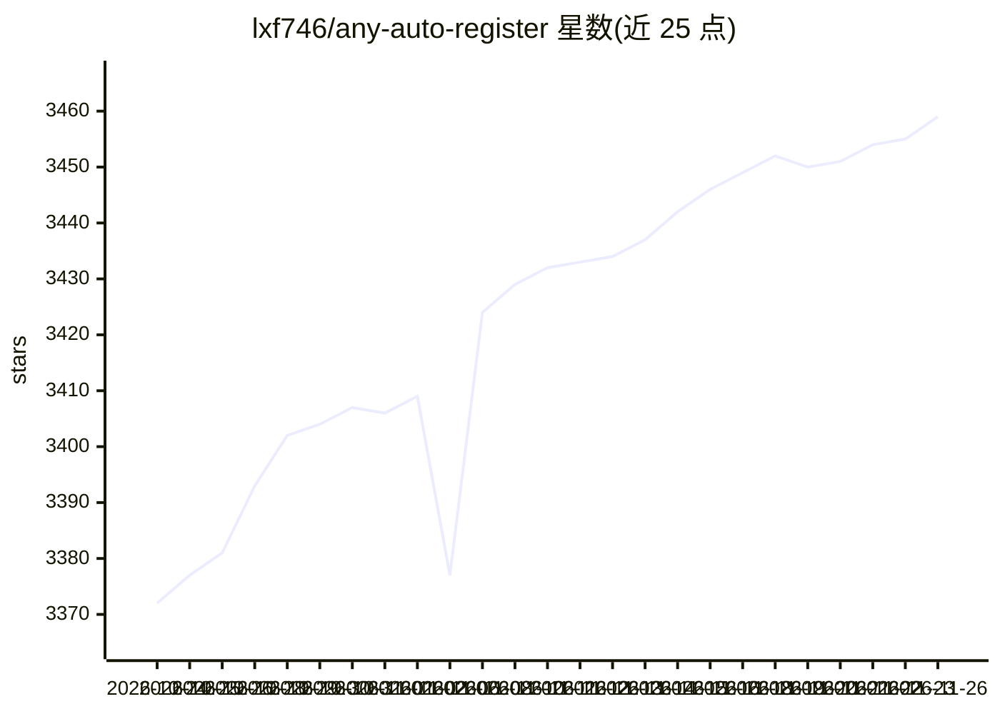

# lxf746/any-auto-register

⭐ 3,459 · Python · AGPL-3.0 · 推送 2026-11-11 · [GitHub](https://github.com/lxf746/any-auto-register) · [官网](https://github.com/lxf746/any2api) · 个人维护 · 中文 README

**批量注册与管理 11+ AI 平台账号的自动化工具**

基于 FastAPI + SQLite 的后端与 Electron 桌面客户端，提供 ChatGPT、Cursor、Grok、Windsurf 等 11+ 平台的批量注册与账号池管理：邮箱、验证码、接码、代理四类驱动均为插件化设计，支持协议/Headless/Headed 三种执行模式。注册后提供定时有效性检测、Token 续期、Trial 过期预警、成功率统计与错误归因，并可与 Any2API 网关联动推送账号。源码版不含任务队列高级控制与激活码管理，桌面版需激活码（加群获取）。

## 筛选速览

| 维度 | 判定 | 备注 |
|---|---|---|
| AI 角色 | `ai-ecosystem` | LLM/agent 周边工具 |
| 许可风险 | `viral` | AGPL-3.0 |
| 部署形态 | `desktop` | 安装包/桌面程序 |
| 模型依赖 | locked-api |  |
| 硬件要求 | — | 无带数字的原话,不猜 |
| 安装摩擦 | `low` | 无编译、无系统依赖或容器化 |
| 成熟度 | — | 结构信号不足 |

## 能力要点

- 平台/邮箱/验证码/接码/代理五类驱动全部插件化热插拔
- 协议（无浏览器）/ Headless / Headed 三种执行模式
- 注册全生命周期管理：定时检测、Token 续期、Trial 预警、风险告警
- SSE 实时日志推送注册每一步，成功率按平台/天/代理细分

## 适用场景

- 批量注册多个 AI 平台账号并统一在账号池管理
- 配合 Any2API 网关将注册账号转为 OpenAI 兼容 API
- 跟踪 trial 账号到期并自动续期 Token

## 场景标签

`浏览器自动化` `工作流自动化` · 领域:效率与自动化

## 证据(README 行号)

> L3: 11+ AI 平台账号自动化注册与管理 · 协议 / 浏览器双模式 · Mac / Windows 桌面版一键启动
> L31: 多数同类项目只解决"怎么注册某一个平台",留下大量工程化空白:邮箱怎么管、验证码怎么过、代理怎么轮换、注册成功后怎么持续用、Token 过期了怎么办、出错了怎么定位。Any Auto Register 把这些都做了。
> L41: |API 网关联动|无|注册即推送 Any2API,统一接入 OpenAI 兼容协议层|

## 星数曲线

2026-10-24 3,372 → 2026-11-26 3,459（+87）

---
*卡片 v1 · prompt 1.4 · 生成 2026-11-23 · 置信度 high · 依据 README sha `8c6bf10555b2` · [字段定义](../../DATASET.md)*
