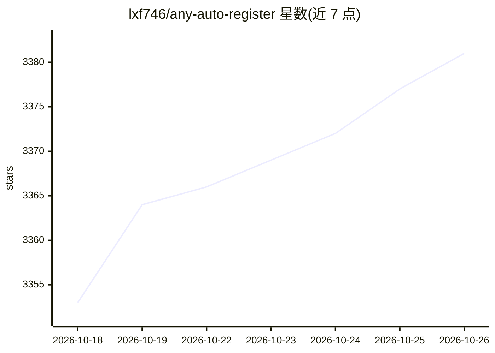

# lxf746/any-auto-register

⭐ 3,381 · Python · AGPL-3.0 · 推送 2026-08-25 · [GitHub](https://github.com/lxf746/any-auto-register) · [官网](https://github.com/lxf746/any2api) · 个人维护 · 中文 README

**11+ AI 平台账号自动化批量注册与生命周期管理桌面工具**

面向 ChatGPT / Cursor / Kiro / Grok / Windsurf 等 11+ AI 平台的账号批量注册与池化管理工具。提供协议（无浏览器）/ Headless / Headed 三种执行模式，覆盖 9 种邮箱通道、YesCaptcha/2Captcha/本地 Camoufox 验证码、接码与代理池轮换；内置 TOTP 本地 2FA、定时有效性检测、Token 自动续期、Trial 预警与成功率统计，注册成功可自动推送到 Any2API 网关。平台/邮箱/验证码/代理均为热插拔插件架构。提供 Mac/Windows 桌面安装包（需激活码）、Docker 与源码三种部署方式。README 声明仅供学习研究，使用者需自行遵守目标平台服务条款。

## 筛选速览

| 维度 | 判定 | 备注 |
|---|---|---|
| AI 角色 | `ai-ecosystem` | LLM/agent 周边工具 |
| 许可风险 | `viral` | AGPL-3.0 |
| 部署形态 | `desktop` | 安装包/桌面程序 |
| 模型依赖 | — | README 未给出锁定关系 |
| 硬件要求 | — | 无带数字的原话,不猜 |
| 安装摩擦 | `low` | 无编译、无系统依赖或容器化 |
| 成熟度 | — | 结构信号不足 |

## 能力要点

- 协议 / Headless / Headed 三种执行模式，按平台切换
- 全插件化：平台 / 邮箱 / 验证码 / 接码 / 代理驱动热插拔
- 生命周期管理：定时有效性检测 + Token 自动续期 + Trial 预警 + 风险告警
- 注册成功自动推送 Any2API 网关，导出 JSON/CSV 等格式

## 适用场景

- 批量注册并池化管理多个 AI 平台账号
- 定时检测账号有效性并自动续期 Token
- 把注册好的账号推送到 Any2API 网关统一作为 API 使用
- 通过成功率统计与错误归因排查代理/邮箱问题

## 场景标签

`浏览器自动化` `工作流自动化` · 领域:效率与自动化

## 证据(README 行号)

> L31: 多数同类项目只解决"怎么注册某一个平台",留下大量工程化空白:邮箱怎么管、验证码怎么过、代理怎么轮换、注册成功后怎么持续用、Token 过期了怎么办、出错了怎么定位。Any Auto Register 把这些都做了。
> L44: 配合 `Any2API` 网关可以一键打通:批量注册账号 → 自动推送 → 立即作为 OpenAI / Claude 兼容 API 使用。
> L97: - **Any2API 联动**:注册成功后自动推送账号到网关,即注册即用

## 星数曲线

2026-10-18 3,353 → 2026-10-26 3,381（+28）

---
*卡片 v1 · prompt 1.4 · 生成 2026-10-20 · 置信度 high · 依据 README sha `7c5dcc6373ab` · [字段定义](../../DATASET.md)*
