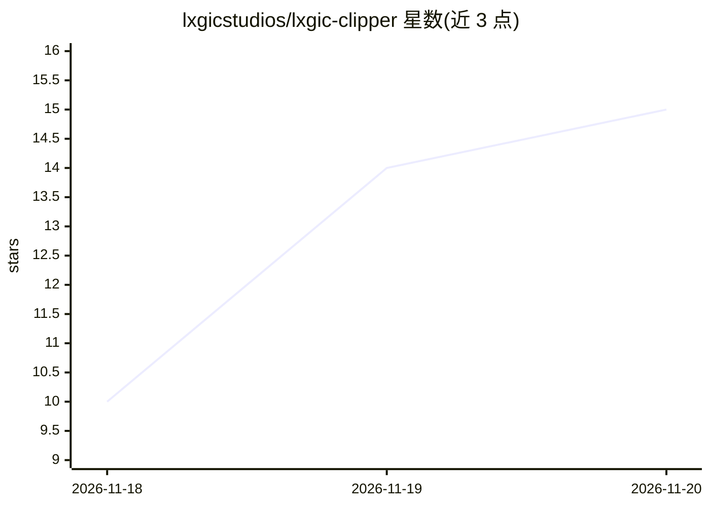

# lxgicstudios/lxgic-clipper

⭐ 15 · Shell · MIT · 推送 2026-02-16 · [GitHub](https://github.com/lxgicstudios/lxgic-clipper) · 组织维护

**给主播自动剪辑直播集锦并分发到社媒的 agent**

面向 Twitch/YouTube/Kick 直播主的自动化剪辑流水线：录制整场直播，通过音频尖峰、聊天频率、游戏状态变化与画面运动检测高光片段，剪成各平台格式并烧入字幕，经 Postiz API 发布到 TikTok、Shorts、Reels、X。技术栈为 Shell 脚本编排：yt-dlp 录制、FFmpeg 分析与剪辑、Whisper 转录、OpenClaw cron 调度。免费版限 1 个直播间、每流 3 条且带水印，付费计划通过 Whop 购买。

## 筛选速览

| 维度 | 判定 | 备注 |
|---|---|---|
| AI 角色 | `ai-native` | 本体是模型或模型工具 |
| 许可风险 | `permissive` | MIT |
| 部署形态 | `None` |  |
| 模型依赖 | — | README 未给出锁定关系 |
| 硬件要求 | — | 无带数字的原话,不猜 |
| 安装摩擦 | `medium` | 含编译或系统依赖之一 |
| 成熟度 | — | 结构信号不足 |

## 能力要点

- 高光检测综合音频、聊天速度、游戏状态与视觉运动信号
- 检测到上传约 3 分钟，含各平台格式转换与自动字幕
- yt-dlp 录制 + FFmpeg 剪辑 + Whisper 转录 + Postiz 发布的 Shell 编排
- 通过 OpenClaw cron 任务实现全自动定时运行

## 适用场景

- 直播打游戏时自动剪出击杀、搞笑瞬间并发到 TikTok
- 不想雇剪辑师的主播把 VOD 自动转成短视频矩阵分发
- 一次配置后无人值守地定时检测、剪辑与发布

## 场景标签

`图像视频处理` · 领域:感知与多模态

## 证据(README 行号)

> L3: **The AI agent that clips your livestreams and posts them automatically.**
> L14: 2. **AI watches everything** — Audio spikes, chat velocity, game state changes, visual motion. It knows what's clip

## 星数曲线

2026-11-18 10 → 2026-11-20 15（+5）

---
*卡片 v1 · prompt 1.4 · 生成 2026-11-19 · 置信度 high · 依据 README sha `9b73bf27ac12` · [字段定义](../../DATASET.md)*
