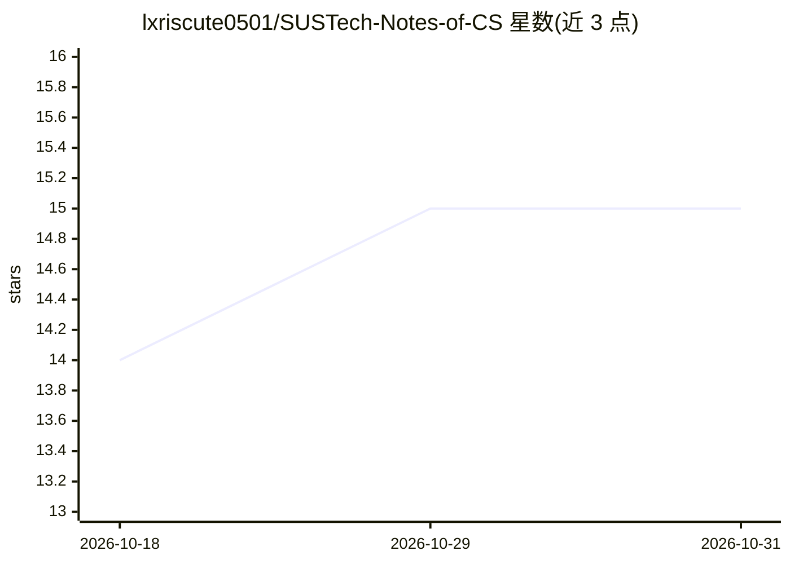

# lxriscute0501/SUSTech-Notes-of-CS

⭐ 15 · Jupyter Notebook · 推送 2026-06-19 · [GitHub](https://github.com/lxriscute0501/SUSTech-Notes-of-CS) · 个人维护 · 中文 README

**南科大计算机系本科课程学习资料合集**

由一名南科大数学系学生整理的计算机系课程资料仓库，覆盖 CS109 程序设计、CS203 数据结构与算法、CS302 操作系统、CS303 人工智能、CS307 数据库、CS324 深度学习、CS310 自然语言处理等约 18 门课程的课件、Lab 资料、Lab 作业、理论作业、Quiz 与 Project，并逐课程标注学期、任课教师与资料完备程度。labOJ 部分补充了题目描述以便自学，作者声明不保证代码全部正确，欢迎通过 Issue 与 Pull Request 补充。

## 筛选速览

| 维度 | 判定 | 备注 |
|---|---|---|
| AI 角色 | `ai-knowledge` | 知识聚合/清单类 |
| 许可风险 | `none` | — |
| 部署形态 | `None` |  |
| 模型依赖 | — | README 未给出锁定关系 |
| 硬件要求 | — | 无带数字的原话,不猜 |
| 安装摩擦 | `low` | 无编译、无系统依赖或容器化 |
| 成熟度 | — | 结构信号不足 |

## 能力要点

- 约 18 门计算机系课程资料，含 PPT/Lab/作业/Quiz/Project
- labOJ 题目附题目描述，可脱离具体年份自学
- 逐课程标注学期、教师与资料完整度（✅/-）
- 接受 Issue 与 Pull Request 社区补充

## 适用场景

- 自学南科大计算机系课程内容与配套实验
- 选课前参考课程安排与资料完备情况
- 对照参考他人实现来调试自己的课程作业（作者提醒勿直接复制）

## 场景标签

`教程课程` · 领域:学习与行业

## 证据(README 行号)

> L1: # 南科大计算机系课程资料
> L13: |课程|学期|老师|备注|
> L37: |课程|理论PPT|Lab资料|Lab作业|理论作业|Quiz|Project|

## 星数曲线

2026-10-18 14 → 2026-10-31 15（+1）

---
*卡片 v1 · prompt 1.4 · 生成 2026-10-30 · 置信度 high · 依据 README sha `b78ea137829e` · [字段定义](../../DATASET.md)*
