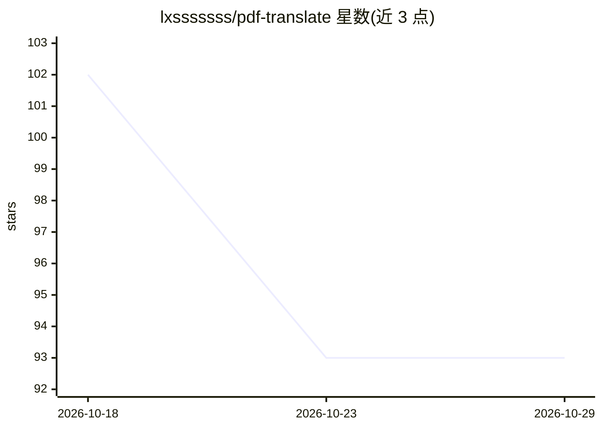

# lxsssssss/pdf-translate

⭐ 93 · Python · MIT · 推送 2026-10-23 · [GitHub](https://github.com/lxsssssss/pdf-translate) · 个人维护 · 中文 README

**供 AI Agent 调用的高保真 PDF 翻译技能与审计工具**

面向 AI 编程助手与智能体的 Agent Skill：以 SKILL.md 规则加 Python 脚本形式提供 PDF 翻译流水线——PyMuPDF 结构探测分块、两阶段数据契约抽取与直译、Playwright/Chromium 渲染全矢量 PDF，并附 render_pdf.py 渲染与 audit_pdf.py 审计脚本（页数 1:1、矢量层、条款编号双向 Diff、占位符扫描）。兼容 Claude Code、Cursor、Windsurf、Antigravity、Codex、DeepSeek 等平台，通过规则文件或系统提示词接入，需 Python 3.8+ 与 Playwright。

## 筛选速览

| 维度 | 判定 | 备注 |
|---|---|---|
| AI 角色 | `ai-ecosystem` | LLM/agent 周边工具 |
| 许可风险 | `permissive` | MIT |
| 部署形态 | `library` | 以包/库形式分发 |
| 模型依赖 | — | README 未给出锁定关系 |
| 硬件要求 | — | 无带数字的原话,不猜 |
| 安装摩擦 | `low` | 无编译、无系统依赖或容器化 |
| 成熟度 | — | 结构信号不足 |

## 能力要点

- 两阶段零幻觉契约：结构化条款树抽取后模板化填装
- JS 浏览器高度溢出探针检测分页溢出
- audit_pdf.py 自动审计页数/矢量层/条款编号/占位符
- 多平台 Agent 接入（Claude Code/Cursor/Windsurf/Codex/DeepSeek 等）

## 适用场景

- 让编程助手把合同、标书、论文翻译为保持排版的 PDF
- 翻译后自动审计页数与条款一致性
- 在 Cursor/Claude Code 等环境中作为技能调用

## 场景标签

 · 领域:文档翻译/Agent 工具

## 证据(README 行号)

> L5: > **High-Fidelity Vector PDF Translation, Layout Reconstruction & Automated Audit Engine for AI Agents.**
> L131: 本项目设计为**跨平台、零依赖摩擦的通用 Agent 技能**，原生兼容目前主流 AI 编程助手与大模型智能体环境：
> L135: |**Google Antigravity**|`.agent/skills/pdf-translate/`|原生 Skill 识别，自动探测与 5 步 SOP 闭环|

## 星数曲线

2026-10-18 102 → 2026-10-29 93（-9）

---
*卡片 v1 · prompt 1.4 · 生成 2026-10-23 · 置信度 mid · 依据 README sha `fd94991aac59` · [字段定义](../../DATASET.md)*
