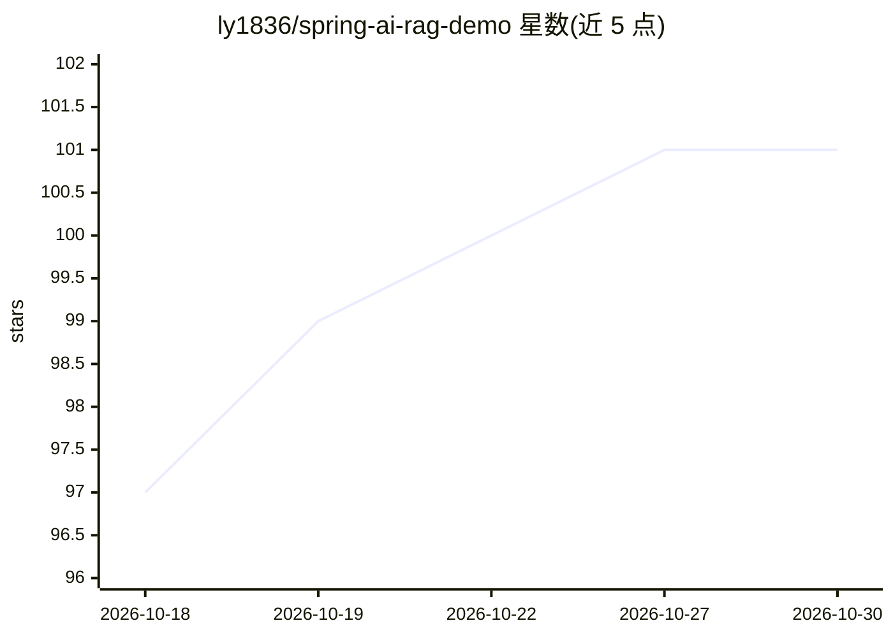

# ly1836/spring-ai-rag-demo

⭐ 101 · Java · Apache-2.0 · 推送 2026-09-08 · [GitHub](https://github.com/ly1836/spring-ai-rag-demo) · 个人维护 · 中文 README

**面向制造业 ERP 的 Spring AI 智能助手：RAG 问答+实时业务数据查询**

基于 Spring Boot 4 与 Spring AI 2.0 构建的制造业 ERP 智能助手应用。提供 Tool Calling（8 大 ERP 模块 39 个代码工具 + 数据库动态 SQL Tool，查询 MySQL 实时业务数据）、RAG（PgVector 检索用户导入知识文档，嵌入模型本地 ONNX 推理）、流式对话（SSE）、会话记忆、多租户隔离（ent_code）、按 token 计费管理，以及 23 种 ECharts 业务数据图表可视化。支持 DeepSeek/通义千问/Gemini 多模型切换。面向 ERP 场景开发者与业务用户，需自建 PostgreSQL+PgVector 与 MySQL，并配置至少一个模型 API Key。

## 筛选速览

| 维度 | 判定 | 备注 |
|---|---|---|
| AI 角色 | `ai-native` | 本体是模型或模型工具 |
| 许可风险 | `permissive` | Apache-2.0 |
| 部署形态 | `self-host` | docker 或自建部署 |
| 模型依赖 | locked-api |  |
| 硬件要求 | — | 无带数字的原话,不猜 |
| 安装摩擦 | `low` | 无编译、无系统依赖或容器化 |
| 成熟度 | — | 结构信号不足 |

## 能力要点

- Tool Calling 覆盖 8 大 ERP 模块 39 个工具方法，支持自然语言时间表达
- RAG 基于 PgVector + 本地 ONNX 嵌入模型，含版本化评测与回答引用
- 23 种 ECharts 图表：LLM 仅选类型与标题，后端生成受控 ChartSpec
- 多租户 ent_code 隔离、动态 Tool 管理与命中追踪、按 token 计费

## 适用场景

- 通过对话实时查询 ERP 销售/采购/生产/库存等业务数据并生成图表
- 上传企业知识文档做 RAG 问答，回答附可信引用
- 多租户场景下按企业隔离数据查询与知识库检索

## 场景标签

`文档问答` `数据分析` `聊天机器人` · 领域:效率与自动化

## 证据(README 行号)

> L5: 基于 Spring AI 构建的制造业 ERP 智能助手，集成了 **Tool Calling**（实时查询业务数据）和 **RAG**（检索用户导入的知识文档）两大 AI 能力，支持多模型切换、流式对话、会话记忆、多租户隔离、计费
> L26: - **Spring AI Tool Calling** — LLM 自动调用 8 大 ERP 模块的代码 `@Tool` 和数据库动态 Tool 查询 MySQL 实时数据
> L28: - **Spring AI RAG** — `RetrievalAugmentationAdvisor` 从 PgVector 检索受管知识库文档片段并注入 prompt 上下文

## 星数曲线

2026-10-18 97 → 2026-10-30 101（+4）

---
*卡片 v1 · prompt 1.4 · 生成 2026-10-24 · 置信度 high · 依据 README sha `80644082f686` · [字段定义](../../DATASET.md)*
