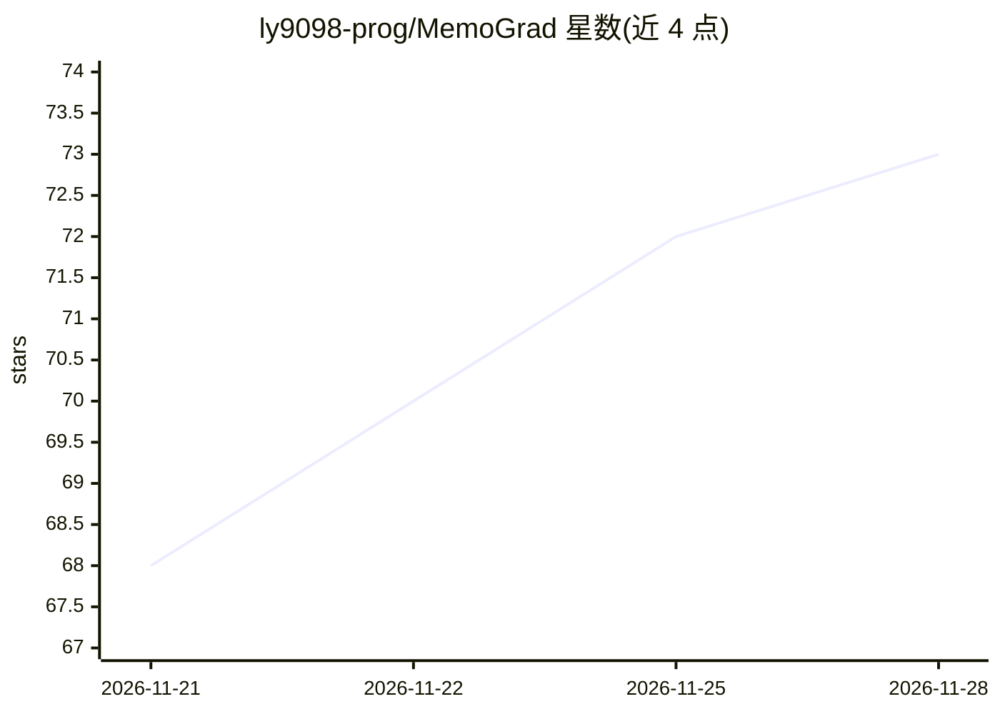

# ly9098-prog/MemoGrad

⭐ 73 · Python · NOASSERTION · 推送 2026-11-27 · [GitHub](https://github.com/ly9098-prog/MemoGrad) · [官网](https://xzshub.top) · 个人维护 · 中文 README

**408 考研刷题平台：题库治理、错题复习与 AI 导题讲解**

覆盖微信小程序端、Next.js 管理后台与 FastAPI 后端的考研 408 刷题平台：题库版本治理、OCR/AI 导题与人工审核、错题本与间隔复习调度、学习报告与自适应路径。AI 部分经统一网关管理，凭据集中配置，具备并发、限流、熔断、Token 预算与健康状态控制。后端按 web/worker/scheduler 角色拆分，使用 Redis 任务队列，提供 Docker Compose 生产部署。许可证为 PolyForm Noncommercial 1.0.0，限制商业用途。

## 筛选速览

| 维度 | 判定 | 备注 |
|---|---|---|
| AI 角色 | `ai-enhanced` | 去掉 AI 部分产品仍成立 |
| 许可风险 | `none` | NOASSERTION |
| 部署形态 | `self-host` | docker 或自建部署 |
| 模型依赖 | — | README 未给出锁定关系 |
| 硬件要求 | — | 无带数字的原话,不猜 |
| 安装摩擦 | `low` | 无编译、无系统依赖或容器化 |
| 成熟度 | — | 结构信号不足 |

## 能力要点

- 微信小程序端刷题、错题、复习调度、公式卡与 408 考试
- OCR 导题流水线：页面处理、识别、纠错、拆题、质量门禁
- AI 统一网关：凭据集中配置、并发限流、熔断与 Token 预算
- Docker Compose 生产部署，含 Nginx、pgvector 与备份任务

## 适用场景

- 备考 408 时刷题、整理错题并按间隔复习
- 搭建自部署的考研题库与学习运营平台
- 批量导入纸质题目并用 OCR/AI 拆题入库
- 给学员提供题目讲解与错因分析

## 场景标签

`文档解析` · 领域:知识与检索

## 证据(README 行号)

> L30: MemoGrad 是一套完整的考研刷题平台，覆盖微信小程序端、管理后台和后端平台。项目不仅处理练习与错题记录，还治理题库版本、OCR/AI 导题、学习调度、推荐实验、权限审计和异步任务。
> L95: - AI 统一网关：凭据集中配置、并发与限流、熔断、Token 预算、健康缓存。
> L78: - AI 能力：题目讲解、错因分析、学习建议。

## 星数曲线

2026-11-21 68 → 2026-11-28 73（+5）

---
*卡片 v1 · prompt 1.4 · 生成 2026-11-21 · 置信度 high · 依据 README sha `cbcd2e096e7f` · [字段定义](../../DATASET.md)*
