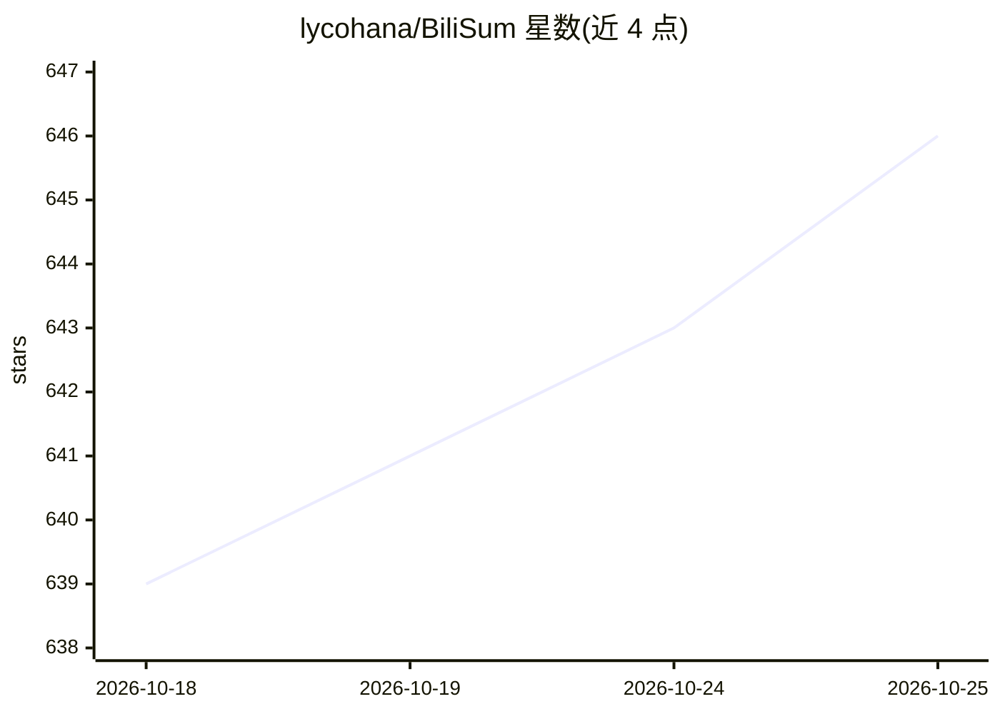

# lycohana/BiliSum

⭐ 646 · Python · MIT · 推送 2026-09-10 · [GitHub](https://github.com/lycohana/BiliSum) · 个人维护 · 中文 README

**面向 B 站/YouTube/本地视频的 AI 转写、摘要与知识库工具**

支持 B 站、YouTube 与本地视频（mp4/mkv/mov/webm）的转写、结构化摘要、时间轴笔记、VLM 图文笔记、思维导图生成，并以本地落盘的知识库提供跨视频语义/关键词检索与 RAG 问答，支持本地 Embedding 与本地 LLM。转写来源包括 SiliconFlow ASR、多模态 ASR、本地 Whisper、FunASR（QwenASR）。提供 Windows/macOS 桌面端、npm CLI、供 Codex/Claude/Cursor 等调用的 skill 及 Docker 部署，可导出 Markdown 与 Obsidian 格式。

## 筛选速览

| 维度 | 判定 | 备注 |
|---|---|---|
| AI 角色 | `ai-native` | 本体是模型或模型工具 |
| 许可风险 | `permissive` | MIT |
| 部署形态 | `self-host` | docker 或自建部署 |
| 模型依赖 | — | README 未给出锁定关系 |
| 硬件要求 | — | 无带数字的原话,不猜 |
| 安装摩擦 | `low` | 无编译、无系统依赖或容器化 |
| 成熟度 | — | 结构信号不足 |

## 能力要点

- B 站/YouTube/本地视频转写→笔记→思维导图→知识库的完整流水线
- 跨视频语义检索、RAG 问答与标签关系网络，数据保存在本机
- VLM 理解型图文笔记，画面信息重新组织文章并精选配图
- 桌面端、CLI、Agent skill 与 Docker 四种使用形态

## 适用场景

- 把 B 站或 YouTube 视频整理成结构化笔记和思维导图
- 跨多个视频构建本地知识库并做 RAG 问答
- 让 Codex/Claude/Cursor 等 Agent 通过 skill 调用视频总结能力

## 场景标签

`知识库管理` `RAG` · 领域:知识与检索

## 证据(README 行号)

> L9: > 深度优化 B 站体验，同时支持 YouTube 与本地视频。自动转写、总结、图文笔记、思维导图、知识库 RAG 问答，数据全部落本地。
> L61: - SiliconFlow ASR、多模态 ASR、本地 Whisper、FunASR（QwenASR）
> L68: - 跨视频语义检索、关键词检索与 RAG 问答

## 星数曲线

2026-10-18 639 → 2026-10-25 646（+7）

---
*卡片 v1 · prompt 1.4 · 生成 2026-10-21 · 置信度 high · 依据 README sha `1bcdae028faa` · [字段定义](../../DATASET.md)*
