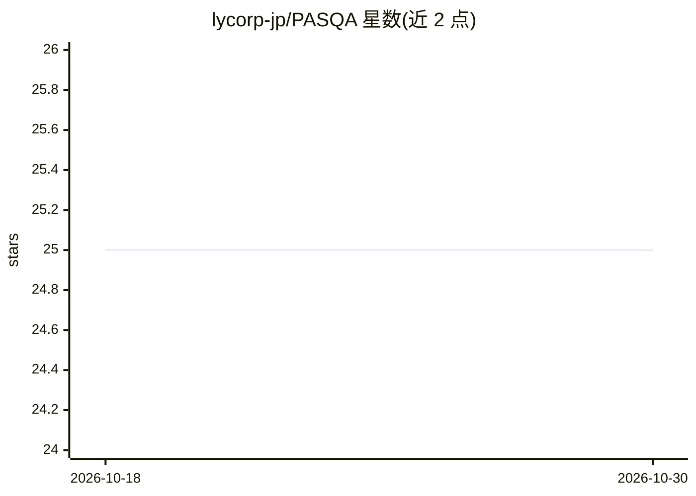

# lycorp-jp/PASQA

⭐ 25 · Python · CC0-1.0 · 推送 2026-09-18 · [GitHub](https://github.com/lycorp-jp/PASQA) · 组织维护

**面向音高重音正确性的日语语音质量 MOS 预测模型**

LY Corporation 为论文发布（已被 INTERSPEECH 2026 接收）的 MOS 预测模型 PASQA：在由重音可控 TTS 变换重音模式构建的受控日语重音错误数据集上训练，使用伪重音质量分数；方法上基于自监督表示，采用 mora 条件融合、排序损失、辅助重音错误定位任务与说话人不变训练。提供 uv 安装、Hugging Face 预训练 checkpoint 下载与 PasqaPredictor 推理接口。仓库为临时开源，可能随时转为只读或私有，不接受贡献。

## 筛选速览

| 维度 | 判定 | 备注 |
|---|---|---|
| AI 角色 | `ai-native` | 本体是模型或模型工具 |
| 许可风险 | `viral` | CC0-1.0 |
| 部署形态 | `None` |  |
| 模型依赖 | — | README 未给出锁定关系 |
| 硬件要求 | — | 无带数字的原话,不猜 |
| 安装摩擦 | `low` | 无编译、无系统依赖或容器化 |
| 成熟度 | — | 结构信号不足 |

## 能力要点

- 针对重音正确性的 MOS 预测模型
- 基于重音可控 TSS 构建的日语重音错误数据集与伪质量分数训练
- 自监督表示 + mora 条件融合 + 排序损失 + 重音错误定位辅助任务
- 提供 Hugging Face 预训练 checkpoint 与 Python 推理接口

## 适用场景

- 评估合成日语语音的重音正确性
- 为语音合成研究提供 MOS 预测打分
- 重音错误定位分析

## 场景标签

`模型评测` · 领域:评测与运维

## 证据(README 行号)

> L12: **PASQA (Pitch-Accent-focused Speech Quality Assessment)** is a mean opinion score (MOS)
> L13: prediction model that explicitly targets pitch-accent correctness. It is trained on a

## 星数曲线

2026-10-18 25 → 2026-10-30 25（+0）

---
*卡片 v1 · prompt 1.4 · 生成 2026-10-27 · 置信度 high · 依据 README sha `889516252537` · [字段定义](../../DATASET.md)*
