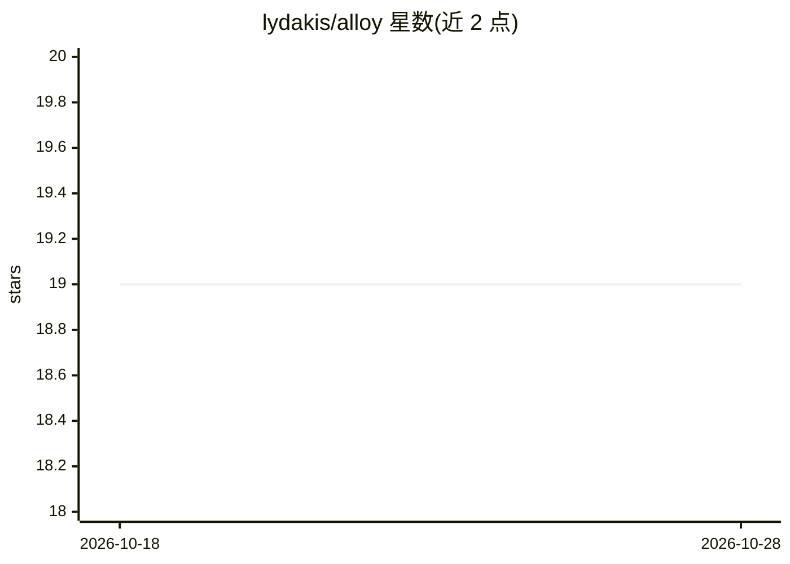

# lydakis/alloy

⭐ 19 · Python · MIT · 推送 2026-06-01 · [GitHub](https://github.com/lydakis/alloy) · [官网](https://alloy.fyi) · 个人维护

**以普通 Python 函数形式编写类型化 LLM 函数的库**

面向开发者的 Python 库：用 @command 装饰器把 AI 调用写成带类型注解的普通函数，由提供方强制结构化输出返回真实 Python 对象（float、dataclass、TypedDict）；提供 @tool 工具调用与 ensure/require 契约机制、流式输出、重试与跨提供方支持。支持 OpenAI、Anthropic、Google 及本地 ollama，通过 pip 以 extras 方式安装各提供方；另提供 ALLOY_BACKEND=fake 离线运行示例的方式。

## 筛选速览

| 维度 | 判定 | 备注 |
|---|---|---|
| AI 角色 | `ai-ecosystem` | LLM/agent 周边工具 |
| 许可风险 | `permissive` | MIT |
| 部署形态 | `library` | 以包/库形式分发 |
| 模型依赖 | local-ok | 支持本地模型 |
| 硬件要求 | — | 无带数字的原话,不猜 |
| 安装摩擦 | `low` | 无编译、无系统依赖或容器化 |
| 成熟度 | — | 结构信号不足 |

## 能力要点

- @command 装饰器声明输出类型，返回真实 Python 对象而非字符串
- @tool 与 ensure/require 契约机制构建多步工作流
- 跨提供方支持（OpenAI/Anthropic/Google/ollama），同一代码零改动切换
- fake 后端可离线运行示例

## 适用场景

- 在应用中调用 LLM 获得类型安全的结构化输出
- 构建带工具调用与契约约束的多步 AI 工作流
- 同一套代码在云端 API 与本地 ollama 之间切换

## 场景标签

`Agent 框架` `模型网关` · 领域:Agent 开发

## 证据(README 行号)

> L19: Write typed AI functions that feel like normal Python. No framework, no abstractions —
> L123: Works with major providers — same code, zero changes:

## 星数曲线

2026-10-18 19 → 2026-10-28 19（+0）

---
*卡片 v1 · prompt 1.4 · 生成 2026-10-28 · 置信度 high · 依据 README sha `97b587c7cc6e` · [字段定义](../../DATASET.md)*
