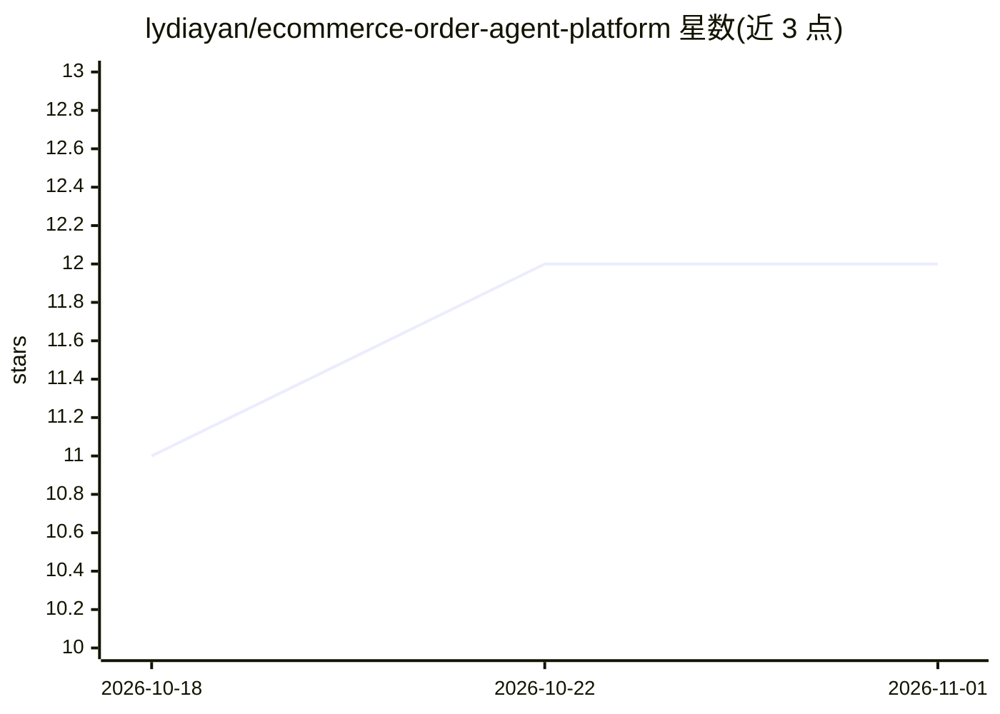

# lydiayan/ecommerce-order-agent-platform

⭐ 12 · Java · MIT · 推送 2026-09-01 · [GitHub](https://github.com/lydiayan/ecommerce-order-agent-platform) · 个人维护 · 中文 README

**面向电商订单场景的可观测 AI Agent 平台，带 RAG 与人工审批**

基于 Spring AI Alibaba StateGraph 的电商订单 Agent 系统：按问题路由到订单查询、RAG 问答、记忆或敏感操作；退款/退货/取消等必须人工确认后恢复 Graph，售后经 MCP 调用订单服务真实落库。混合记忆采用 Redis 短期会话、Milvus 长期语义、MySQL 用户画像；Trace 经 RocketMQ 异步写入 Elasticsearch，供 AgentInsight 做质量评测。提供 8 个演示账户的权限工作区，需 JDK 17+、Docker Compose 与 DashScope API Key，通过脚本启动 MySQL/Redis/Milvus/RocketMQ/ES 及 4 个应用进程。限制：checkpoint 存单进程内存，Compose 仅面向本地开发。

## 筛选速览

| 维度 | 判定 | 备注 |
|---|---|---|
| AI 角色 | `ai-native` | 本体是模型或模型工具 |
| 许可风险 | `permissive` | MIT |
| 部署形态 | `self-host` | docker 或自建部署 |
| 模型依赖 | — | README 未给出锁定关系 |
| 硬件要求 | — | 无带数字的原话,不猜 |
| 安装摩擦 | `low` | 无编译、无系统依赖或容器化 |
| 成熟度 | — | 结构信号不足 |

## 能力要点

- StateGraph 编排订单查询/RAG/记忆/敏感操作四类路由
- 敏感订单操作强制 Human-in-the-Loop 中断与恢复
- Trace 经 RocketMQ 写入 Elasticsearch，对接 AgentInsight 评测
- 退款资格由订单服务确定性计算，大模型仅解释不改写

## 适用场景

- 电商售后场景中带人工确认的订单 Agent 执行链
- 企业内多角色（HR/研发/销售/客户）权限隔离的知识问答
- Agent 执行轨迹的可观测与质量回归评测

## 场景标签

`LLM 可观测性` `模型评测` `RAG` · 领域:评测与运维

## 证据(README 行号)

> L3: 一个面向电商订单场景的可观测 AI Agent：使用 Spring AI Alibaba StateGraph 编排规划、记忆、RAG、订单工具和人工确认，并把完整执行轨迹异步写入 Elasticsearch，供 AgentInsi
> L29: - **确定性规划**：按问题路由到订单查询、RAG 问答、记忆或敏感订单操作。
> L30: - **Human-in-the-Loop**：退款、退货、换货、取消订单和改址必须先中断，用户确认后才恢复 Graph。

## 星数曲线

2026-10-18 11 → 2026-11-01 12（+1）

---
*卡片 v1 · prompt 1.4 · 生成 2026-11-01 · 置信度 high · 依据 README sha `d556b1089a31` · [字段定义](../../DATASET.md)*
