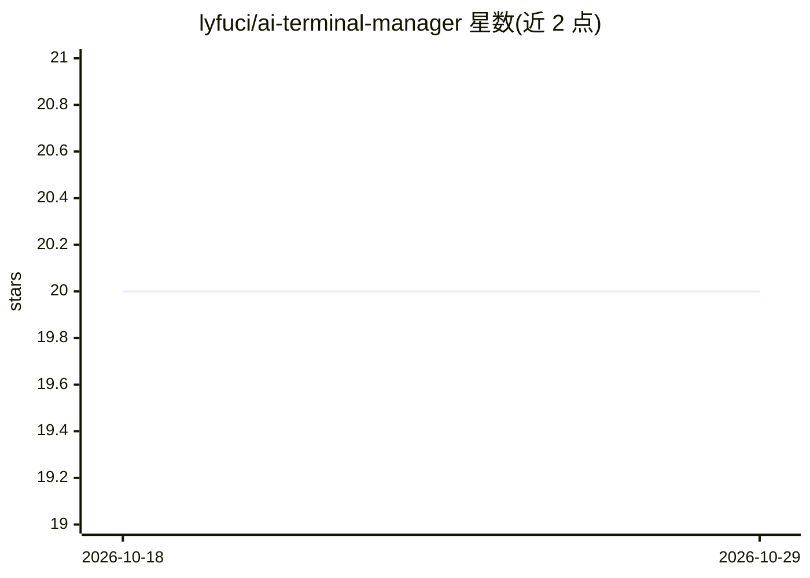

# lyfuci/ai-terminal-manager

⭐ 20 · Python · MIT · 推送 2026-10-18 · [GitHub](https://github.com/lyfuci/ai-terminal-manager) · [官网](https://pypi.org/project/ai-terminal-manager/) · 个人维护 · 中文 README

**tmux 内多 AI CLI 会话的统一管理与恢复工具**

面向在 Linux/WSL2/服务器 tmux 环境中同时开多个 AI CLI 会话的开发者：合并 Claude Code、Codex、Pi、Gemini CLI、opencode 的本地会话历史为一个列表，支持模糊搜索并恢复到指定 tmux pane；提供常驻左侧栏列出运行中的 pane；安装 tmux-resurrect/continuum 实现重启后恢复；通过 atm claude 等命令以 cgroup 内存门控启动 CLI。仅读取本地文件，不上传数据。需 tmux≥3.2、Python≥3.11，零运行时依赖。

## 筛选速览

| 维度 | 判定 | 备注 |
|---|---|---|
| AI 角色 | `ai-ecosystem` | LLM/agent 周边工具 |
| 许可风险 | `permissive` | MIT |
| 部署形态 | `library` | 以包/库形式分发 |
| 模型依赖 | — | README 未给出锁定关系 |
| 硬件要求 | — | 无带数字的原话,不猜 |
| 安装摩擦 | `low` | 无编译、无系统依赖或容器化 |
| 成熟度 | — | 结构信号不足 |

## 能力要点

- 合并五种 AI CLI 的会话历史为单一可模糊搜索列表
- tmux 常驻侧栏：列出运行中 pane 并 swap-pane 切换
- 安装 tmux-resurrect+continuum 实现重启后按需恢复会话
- atm claude/codex/pi 以 cgroup 内存门控启动，失控会话被限制

## 适用场景

- 在服务器上 SSH 开发时管理多个 Claude Code / Codex 会话
- 断线或重启后找回并恢复昨天的 AI 会话
- 用侧栏快速切换各 pane 中正在运行的 AI 会话

## 场景标签

 · 领域:开发者工具/终端

## 证据(README 行号)

> L33: **It is** a tmux session manager for AI CLIs (Claude Code / Codex / Pi / Gemini CLI / opencode). Three things:
> L35: 1. merge the session history of all three CLIs into **one list**, fuzzy-search it, and **drop a session into the
> L45: **For**: people developing in tmux on Linux / WSL2 / servers with several AI sessions open at once.

## 星数曲线

2026-10-18 20 → 2026-10-29 20（+0）

---
*卡片 v1 · prompt 1.4 · 生成 2026-10-28 · 置信度 high · 依据 README sha `d30aa32ad327` · [字段定义](../../DATASET.md)*
