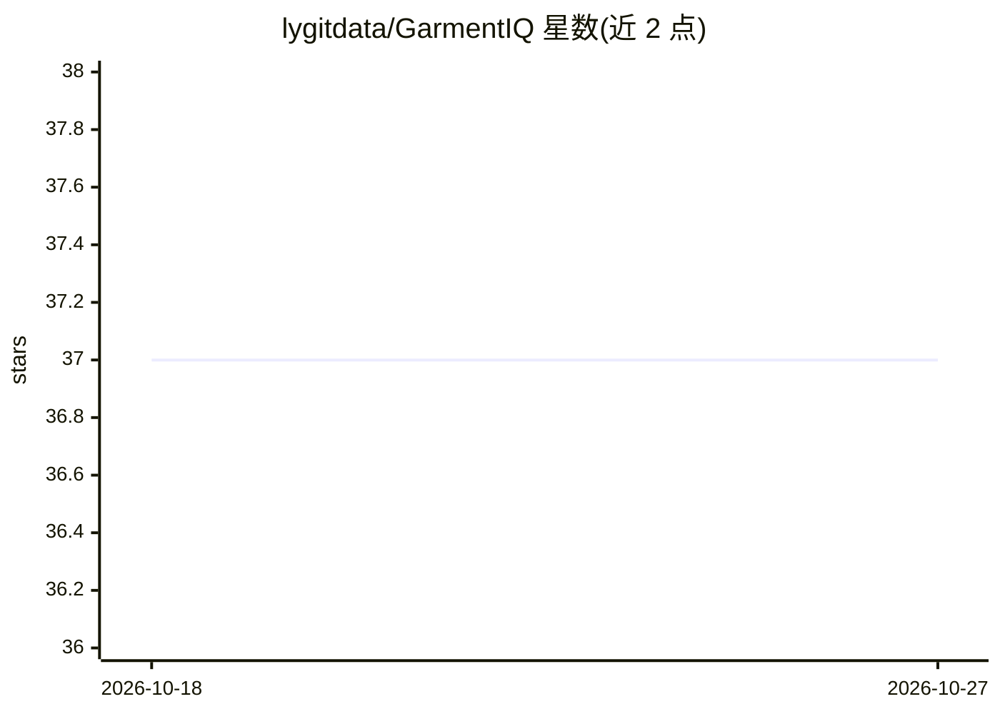

# lygitdata/GarmentIQ

⭐ 37 · Python · MIT · 推送 2026-10-10 · [GitHub](https://github.com/lygitdata/GarmentIQ) · [官网](https://GarmentIQ.ly.gd.edu.kg) · 组织维护

**从图像自动测量服装尺寸的计算机视觉 Python 库**

面向时尚零售的服装图像测量库，整合分类（CNN/tinyViT/DeiT）、分割（BiRefNet、SAM 1/2/3，支持点/框/文本提示）、抠图（ViTMatte、Matting Anything）、关键点检测（HRNet）等模块，由 tailor 模块编排端到端流程并输出测量结果。提供 9 种预定义测量指令 schema，可自定义；所有模型函数接受 device 参数（cpu/cuda/mps）。以 pip 包发布，附 Colab 教程笔记本；部分分类模型含 Inditex（Zara）微调权重。

## 筛选速览

| 维度 | 判定 | 备注 |
|---|---|---|
| AI 角色 | `ai-native` | 本体是模型或模型工具 |
| 许可风险 | `permissive` | MIT |
| 部署形态 | `library` | 以包/库形式分发 |
| 模型依赖 | — | README 未给出锁定关系 |
| 硬件要求 | — | 无带数字的原话,不猜 |
| 安装摩擦 | `medium` | 含编译或系统依赖之一 |
| 成熟度 | — | 结构信号不足 |

## 能力要点

- 分类-分割-关键点-测量端到端流水线（tailor 模块编排）
- 支持 SAM 1/2/3 与自然语言文本提示分割
- 9 种预定义测量 schema，可自定义关键点与测量项
- 内置多个已训练分类模型（含 Inditex 微调版）及训练/微调 API

## 适用场景

- 电商服装商品图自动生成尺寸测量数据
- 批量处理服装图像并输出掩码、标注图与测量值
- 在自己的服装类目上微调分类与关键点模型

## 场景标签

`目标检测` · 领域:感知与多模态

## 证据(README 行号)

> L26: GarmentIQ uses computer vision and models like DeiT, BiRefNet, SAM, and HRNet to classify garments, remove backgrou
> L39: The `garmentiq` package provides an automated solution for garment measurement from images, utilizing computer visi

## 星数曲线

2026-10-18 37 → 2026-10-27 37（+0）

---
*卡片 v1 · prompt 1.4 · 生成 2026-10-25 · 置信度 high · 依据 README sha `00c3c8532acc` · [字段定义](../../DATASET.md)*
