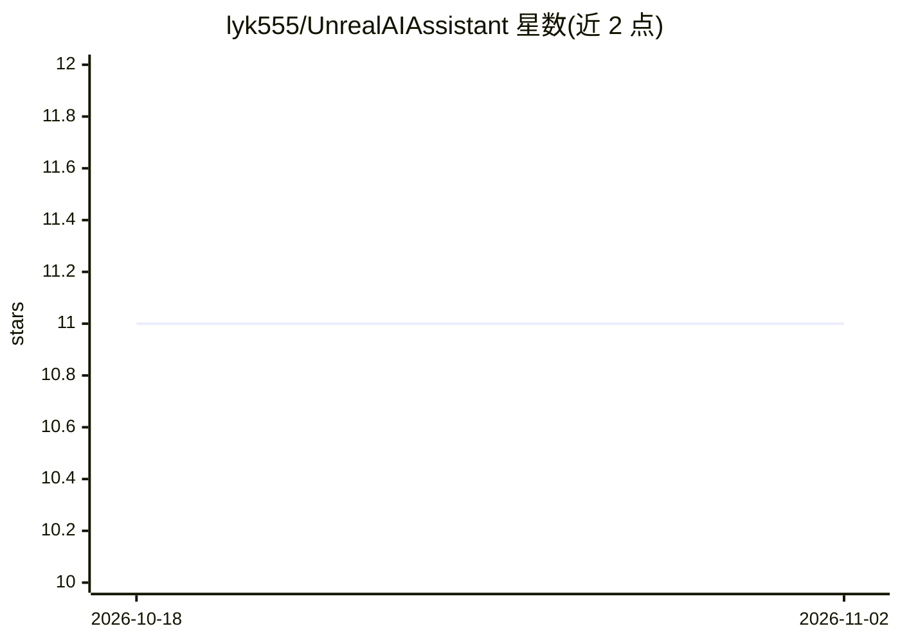

# lyk555/UnrealAIAssistant

⭐ 11 · C++ · MIT · 推送 2026-03-20 · [GitHub](https://github.com/lyk555/UnrealAIAssistant) · 个人维护

**Unreal Engine 5.5 编辑器插件：接入 CodeX/Claude Code 等 AI 编码 CLI**

面向 Unreal Engine 5.5 的编辑器插件，将 OpenAI CodeX 与 Claude Code 等 AI 编码后端 CLI 集成进编辑器，提供可停靠助手面板、后端切换与 Quick Ask。插件在编辑器内启动本地 MCP 服务器（默认端口 3000），并通过 Node.js MCP 桥接（Resources/mcp-bridge）暴露 Unreal 专属工具，覆盖 Actor、关卡、资产、蓝图、动画蓝图、材质、脚本执行、视口捕获与异步任务管理。要求 UE 5.5.x、至少一个后端 CLI 在 PATH 上、Node.js 18+，以 C++ 项目从源码构建。

## 筛选速览

| 维度 | 判定 | 备注 |
|---|---|---|
| AI 角色 | `ai-ecosystem` | LLM/agent 周边工具 |
| 许可风险 | `permissive` | MIT |
| 部署形态 | `library` | 以包/库形式分发 |
| 模型依赖 | locked-api |  |
| 硬件要求 | — | 无带数字的原话,不猜 |
| 安装摩擦 | `low` | 无编译、无系统依赖或容器化 |
| 成熟度 | — | 结构信号不足 |

## 能力要点

- 编辑器内可停靠助手面板，支持后端切换与 Quick Ask
- 本地 MCP 服务器（端口 3000）+ Node.js MCP 桥接
- 工具面覆盖 Actor/蓝图/资产/材质/脚本/视口捕获/异步任务
- 内置工具参数与脚本执行的校验，附自动化测试

## 适用场景

- 在 Unreal 编辑器内直接使用 AI 编码后端操作资产与蓝图
- 让 Claude Code 等 MCP 客户端调用 Unreal 专属工具自动化关卡与材质工作
- 不离开编辑器提交长运行任务并取回结果

## 场景标签

`编码 Agent` · 领域:编码与开发

## 证据(README 行号)

> L11: UnrealAIAssistant is a UE 5.5 editor plugin repository built around the `UnrealAIAssistant` plugin. It integrates A
> L24: - Local MCP server hosted by the plugin on port `3000`
> L41: - At least one supported backend CLI installed and available on `PATH` (`codex` or `claude`)

## 星数曲线

2026-10-18 11 → 2026-11-02 11（+0）

---
*卡片 v1 · prompt 1.4 · 生成 2026-11-02 · 置信度 mid · 依据 README sha `f6c26b26fc14` · [字段定义](../../DATASET.md)*
