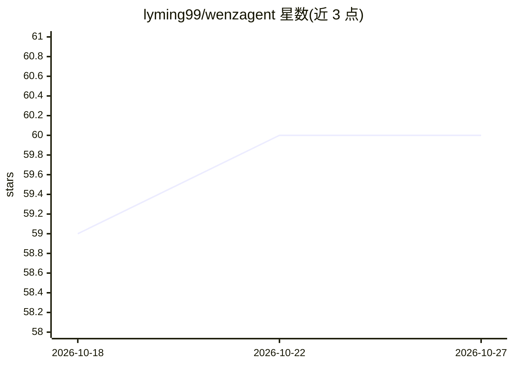

# lyming99/wenzagent

⭐ 60 · Dart · Apache-2.0 · 推送 2026-06-10 · [GitHub](https://github.com/lyming99/wenzagent) · [官网](https://wenzflow.com) · 个人维护 · 中文 README

**纯 Dart 的 AI Agent 管理框架：生命周期·局域网·RPC**

纯 Dart 实现的 AI Agent 管理框架，无需原生依赖可跨平台运行。提供 Agent 生命周期管理与状态追踪（创建→运行→暂停→停止），支持 OpenAI、Anthropic、Google、Ollama 多种 LLM 后端与工具调用；基于 WebSocket 的局域网设备发现、消息收发与大文件分片传输；跨设备 RPC 支持 Agent 远程创建与管理。技能系统兼容 MCP、文件夹提示词与 YAML 配置技能，另有 SQLite 持久化与 Cron 定时任务调度。以 Dart 包（git 依赖）形式安装，附 CLI 服务端/客户端。

## 筛选速览

| 维度 | 判定 | 备注 |
|---|---|---|
| AI 角色 | `ai-ecosystem` | LLM/agent 周边工具 |
| 许可风险 | `permissive` | Apache-2.0 |
| 部署形态 | `None` |  |
| 模型依赖 | local-ok | 支持本地模型 |
| 硬件要求 | — | 无带数字的原话,不猜 |
| 安装摩擦 | `low` | 无编译、无系统依赖或容器化 |
| 成熟度 | — | 结构信号不足 |

## 能力要点

- Agent 生命周期管理与多 LLM 后端（OpenAI/Anthropic/Google/Ollama）
- WebSocket 局域网设备自动发现与文件分片传输
- 跨设备 RPC 远程创建和管理 Agent
- 技能系统支持 MCP、文件夹提示词、YAML 配置与自定义扩展

## 适用场景

- 在 Dart 应用中构建和管理多后端 AI Agent
- 局域网内多设备协同运行与远程调用 Agent
- 通过 MCP 或自定义技能扩展 Agent 能力

## 场景标签

`Agent 框架` · 领域:Agent 开发

## 证据(README 行号)

> L13: **WenzAgent** 是一个纯 Dart 实现的 AI Agent 管理框架，提供完整的 Agent 生命周期管理、局域网设备发现与通信、远程过程调用（RPC）以及可扩展的技能系统。无需原生依赖，可跨平台运行。
> L21: - 🤖 **Agent 系统** — 创建和管理 AI Agent，支持多种 LLM 后端、工具调用和状态管理

## 星数曲线

2026-10-18 59 → 2026-10-27 60（+1）

---
*卡片 v1 · prompt 1.4 · 生成 2026-10-24 · 置信度 high · 依据 README sha `7d75f6fe400a` · [字段定义](../../DATASET.md)*
