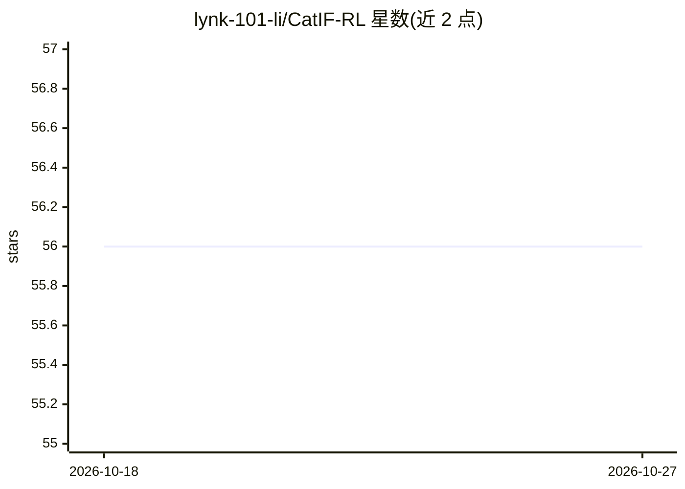

# lynk-101-li/CatIF-RL

⭐ 56 · Python · NOASSERTION · 推送 2026-07-18 · [GitHub](https://github.com/lynk-101-li/CatIF-RL) · 组织维护

**面向科研的酶序列活性导向设计框架：逆向折叠+GRPO后训练**

CatIF-RL 将图结构离散扩散逆向折叠模型改造为以酶转换数（kcat）为设计目标的序列生成器。流程四阶段：EnzymeIF 监督预训练、GDC 生成式数据集筛选（ESMFold 结构门控 + 三个 kcat 预测器集成打分，产出 6,034 条序列）、CatIF 重训、KL 正则化 GRPO 三轮强化学习微调。提供 BLOSUM 迭代融合的子图 inpainting 采样器，可固定催化残基做局部重设计。在 Linux + CUDA 11.7 + 单张 RTX 级 GPU 环境开发，预训练权重与数据需另行下载。

## 筛选速览

| 维度 | 判定 | 备注 |
|---|---|---|
| AI 角色 | `ai-native` | 本体是模型或模型工具 |
| 许可风险 | `permissive` | NOASSERTION |
| 部署形态 | `library` | 以包/库形式分发 |
| 模型依赖 | — | README 未给出锁定关系 |
| 硬件要求 | — | 无带数字的原话,不猜 |
| 安装摩擦 | `medium` | 含编译或系统依赖之一 |
| 成熟度 | — | 结构信号不足 |

## 能力要点

- 四阶段管线：EnzymeIF 预训练 → GDC 数据集筛选 → CatIF 重训 → 三轮 KL 正则 GRPO
- GDC 通过 ESMFold 结构门控与 DLKcat/UniKP/CataPro 三模型集成打分筛选高活性变体
- 离散子图 inpainting 采样器支持固定催化残基的 motif 保留式局部重设计
- 论文复现为 8 步编号脚本，附基准评测与案例研究入口

## 适用场景

- 给定酶骨架结构，生成预测催化活性更高的序列变体
- 固定催化残基位点，重设计其周围序列
- 复现 JCIM 论文的完整训练与基准评测流程

## 场景标签

`科研工具` `强化学习` · 领域:学习与行业

## 证据(README 行号)

> L11:  CatIF-RL recasts a graph-based discrete-diffusion inverse-folding model as an activity-directed enzyme sequence ge
> L15: CatIF-RL recasts a graph-based discrete-diffusion inverse-folding model as an *activity-directed* enzyme sequence g

## 星数曲线

2026-10-18 56 → 2026-10-27 56（+0）

---
*卡片 v1 · prompt 1.4 · 生成 2026-10-24 · 置信度 mid · 依据 README sha `1e4d52c02933` · [字段定义](../../DATASET.md)*
